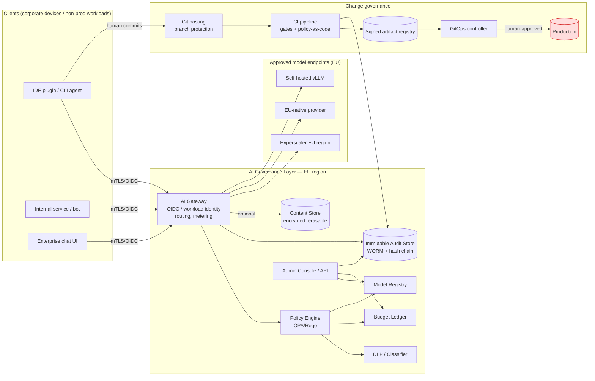
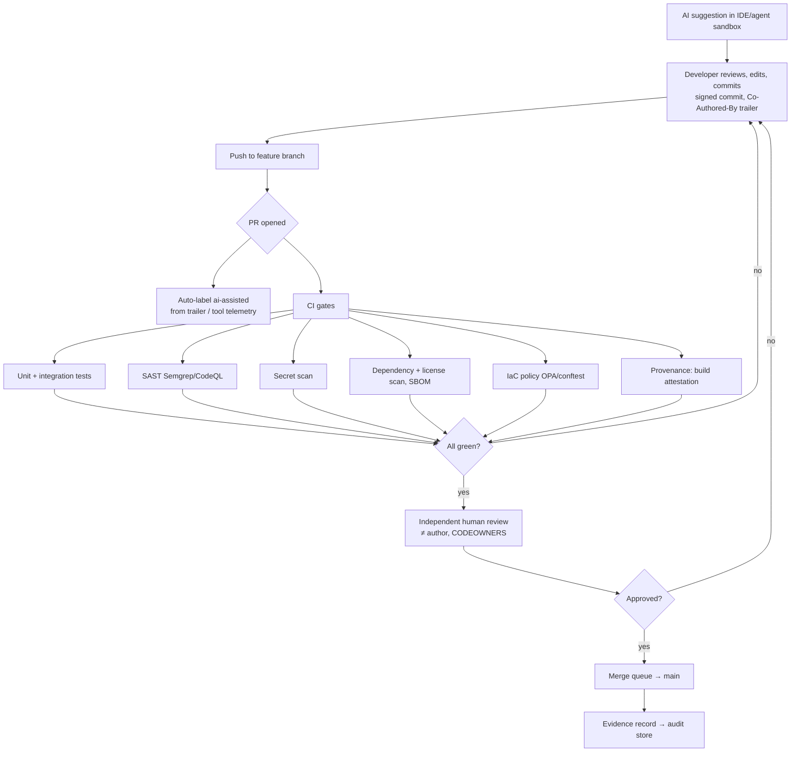

# 02 — Technical Requirements Document (TRD)

**Project:** AI Governance Layer (AGL)
**Status:** Draft v0.1 — options exploration
**Date:** 2026-10-19
**Related:** [01 PRD](01-product-requirements.md) · [03 App Flows](03-app-flows.md) · [05 Backend Schema](05-backend-schema.md) · [06 Implementation Plan](06-implementation-plan.md) · [Decision Log](decision-log.md)

---

## 1. Architecture overview

AGL has two halves that share one identity model and one audit store:

1. **Runtime governance** — the path a prompt takes from a person or workload to a model and back.
2. **Change governance** — the path a code change takes from an AI suggestion to production.

**Hard boundaries**

- Nothing inside `AGL` or `Clients` has a network route to `PROD`. Production is reached only by the GitOps controller pulling signed artifacts, and by humans via existing privileged-access tooling.
- The audit store accepts writes only from the gateway, the CI evidence publisher and the admin API, and accepts no updates or deletes from anyone.

## 2. Component requirements

### 2.1 AI Gateway

| Req | Detail |
|-----|--------|
| T-GW-01 | Terminates TLS; authenticates humans via OIDC (corporate IdP) and services via workload identity (SPIFFE/SVID, cloud IAM OIDC, or short-lived JWT); rejects static API keys |
| T-GW-02 | Exposes an OpenAI-compatible and an Anthropic-compatible API surface so IDE tools can point at it with a base-URL change; also a native API |
| T-GW-03 | Resolves caller → user → team → cost centre from IdP groups (SCIM-synced) |
| T-GW-04 | Calls policy engine *before* forwarding and *after* receiving response (egress inspection of response for leaked secrets is optional) |
| T-GW-05 | Meters input/output/cached tokens per provider price list; writes to budget ledger synchronously (reserve → settle) |
| T-GW-06 | Streams responses; metering settles at stream end |
| T-GW-07 | Provider adapters hold vendor credentials in a secrets manager (EU KMS); clients never see vendor keys |
| T-GW-08 | Fail closed: if policy engine, budget ledger, or audit write is unavailable, request is rejected with a clear error (D-05) |
| T-GW-09 | Horizontal scaling, stateless; ≤ 150 ms p95 overhead |
| T-GW-10 | Supports per-model region pinning; refuses to route to a non-registered (provider, model, region) tuple |

**Candidate implementations:** LiteLLM Proxy (Python, broad provider support, virtual keys, budgets, OSS), Envoy AI Gateway (CNCF, strong for K8s), Kong AI Gateway (plugins), Portkey OSS gateway. Evaluate in Phase 1 spike against T-GW-01..10. Preference: an OSS gateway we can run in EU; budgets and policy live *outside* the gateway (in ledger + OPA) so the gateway is replaceable (NFR-09).

### 2.2 Policy Engine

| Req | Detail |
|-----|--------|
| T-PE-01 | Policy-as-code in Rego (OPA) or Cedar; versioned in Git; CI tests; signed bundles |
| T-PE-02 | Inputs: identity claims, team, requested model, data classification (declared + detected), DLP findings, budget state, time, client type, environment tag |
| T-PE-03 | Outputs: `allow` / `block` / `reroute(model)` + reason codes + obligations (`log_content`: true for every request that reaches a model, D-12). No redact outcome since D-11 |
| T-PE-04 | Decision log for every evaluation sent to audit store |
| T-PE-05 | Hot reload of bundles with rollback |

**Example policy intent** (expressed informally; Rego in repo later):

- `classification >= CONFIDENTIAL` → only models with `residency = EU_SELF_HOSTED` or `EU_PROVIDER_ZERO_RETENTION`. Content is stored like every other class (D-12).
- `classification = RESTRICTED` (production data, secrets, special-category personal data) → **block** always.
- `dlp.secret_detected` → block, notify security.
- `dlp.pii_detected` → block, any classification (D-11). The gateway first sets aside the caller's own registered address and reserved test domains, counted as `own_identity` / `test_data`.
- `identity.roles` has `client` (and not `developer`) and the request is not a product question from `/agl/ask`, or carries repository context → block `CLIENT_SCOPE` (D-13).
- `budget.remaining <= 0` → block; `budget.remaining < 20%` → allow + warn.
- `client.environment = production` → block (there should be no such caller; alert).

### 2.3 DLP / Classifier

| Req | Detail |
|-----|--------|
| T-DLP-01 | Secret detection (regex + entropy; gitleaks/trufflehog rule sets) |
| T-DLP-02 | Personal data detection: names, emails, phone, IBAN, national IDs, health terms (Presidio or equivalent, EU-language models) |
| T-DLP-03 | Company identifiers: customer IDs, internal hostnames, ticket IDs, project codenames (configurable dictionaries) |
| T-DLP-04 | Classification labels from source: IDE plugin passes repository classification (from a repo manifest); documents carry sensitivity labels (MIP/AIP if used) |
| T-DLP-05 | Runs in-region; no third-party DLP SaaS in the hot path |
| T-DLP-06 | ~~Redaction reversible within the request.~~ Superseded by D-11: personal data blocks; exemptions (own address, reserved test domains) are counted in the event; block responses list finding types and counts, never values |

### 2.4 Budget Ledger

| Req | Detail |
|-----|--------|
| T-BUD-01 | Envelopes: org → cost centre → team → project → identity; monthly and optional daily caps; hard and soft thresholds |
| T-BUD-02 | Two-phase accounting: *reserve* estimated cost at request start, *settle* actual at completion; expired reservations released |
| T-BUD-03 | Price list per (provider, model, region) with effective dates; FX handled in EUR |
| T-BUD-04 | Alerts at configurable thresholds to team channel and budget owner |
| T-BUD-05 | Exceptions: top-up requests with justification, approver, expiry; immutable record |
| T-BUD-06 | Monthly close: ledger exported to finance with cost-centre allocation |
| T-BUD-07 | Vendor-side spend caps also configured (defence in depth) and reconciled monthly against ledger |

### 2.5 Model Registry

| Req | Detail |
|-----|--------|
| T-REG-01 | Record per (provider, model, version, endpoint, region): status (`evaluating`, `approved`, `restricted`, `deprecated`, `revoked`), classification ceiling, cost tier, retention terms, sub-processors, DPA reference, DPIA reference, approval date, review date, owner |
| T-REG-02 | Changes only via admin API with dual approval (security + DPO) and written to audit store |
| T-REG-03 | Gateway routes only to `approved`/`restricted` entries |

### 2.6 Immutable Audit Store

| Req | Detail |
|-----|--------|
| T-AUD-01 | One JSON record per gateway request, per policy decision, per budget event, per registry change, per admin action, per CI evidence event |
| T-AUD-02 | Fields: `event_id`, `ts`, `prev_hash`, `hash`, actor (subject, team, client), model tuple, token counts, cost, classification, DLP summary (counts and types, never the matched text), decision, reason codes, request fingerprint (hash of prompt), response fingerprint, provider request id, trace id |
| T-AUD-03 | Written to object storage with Object Lock (compliance mode) or immutable blob policy, in EU region, as hourly or size-bounded segments; each segment hash-chained to the previous; daily *anchor* (root hash) written to a second, independent store (different provider or on-prem HSM-signed) |
| T-AUD-04 | Hot queryable copy in an append-only database table (INSERT-only role, no UPDATE/DELETE grants, trigger-blocked) for dashboards; the object store is the source of truth |
| T-AUD-05 | Retention: configurable per legal; default 24 months WORM, then legal-hold-aware deletion |
| T-AUD-06 | Verification tool: given a date range, re-hash segments and compare to anchors; produces auditor report |
| T-AUD-07 | Streaming copy to SIEM |
| T-AUD-08 | No personal data beyond identity of the caller (an employee) is stored here; prompt content is only a hash. This keeps GDPR erasure obligations away from the immutable store |

### 2.7 Content Store (separate; mandatory since D-12)

| Req | Detail |
|-----|--------|
| T-CNT-01 | Prompt and response bodies, and agent commands with their output, stored wherever policy obligation `log_content=true`: every request that reaches a model, all classifications; blocked requests never. A request that cannot be stored is not sent (D-05, D-12) |
| T-CNT-02 | Encrypted with a separate key per team (PoC: AES-256-GCM, HKDF-derived from one master key, bound to the audit event id); erasable per subject or per request (GDPR) by removing the bodies; the row and fingerprints stay; erasure logged in audit store |
| T-CNT-03 | Retention 30 days (configurable; owner accepted, 2026-10-21), then bodies removed automatically and the count logged |
| T-CNT-04 | Access requires two roles (security + team lead) and is logged. PoC: `security_admin` or `dpo` asks with a reason; a different `security_admin`, `dpo` or `team_lead` approves; the asker reads for 24 h; each step logged (`content_access_requested`, `content_access_approved`, `content_access`) |

### 2.8 Admin Console / API

Dashboards (spend, usage, decisions), audit search (hot copy), registry management, budget management, exception workflow, vendor inventory, evidence export. See [04 Design Brief](04-design-brief.md).

## 3. Identity and access

- **Humans:** corporate IdP → OIDC → gateway. Groups synced via SCIM define team, cost centre, role (`developer`, `team_lead`, `budget_owner`, `security_admin`, `dpo`, `auditor`, `platform_admin`).
- **Workloads:** non-prod services get workload identities. **Production workloads get no gateway identity** in v1 (product-embedded AI is a non-goal).
- **AI agents** (Claude Code, Copilot agent, Cursor agent, custom agents): each run gets a *delegated* identity: `agent:<tool>` acting on behalf of `user:<id>`, with scope limited to the sandbox. Agents never get a standalone cloud IAM principal with production permissions. In cloud IAM, a Service Control Policy / Azure Policy / Org Policy denies any principal tagged `agent=true` from assuming roles in production accounts.
- **Admin actions:** dual approval for registry and policy changes; all logged.

## 4. Options analysis

### 4.1 Model hosting

| Criterion | A. Hyperscaler EU region | B. EU-native provider | C. Self-hosted open weights | D. Direct US endpoint |
|-----------|--------------------------|-----------------------|-----------------------------|-----------------------|
| Data processed in EU | Yes (region pinned); verify no cross-region abuse monitoring / support access; verify training opt-out default | Yes | Yes | Not guaranteed |
| Legal entity / jurisdiction exposure | US parent; CLOUD Act exposure remains → needs Transfer Impact Assessment and supplementary measures | EU entity | Our own | US |
| Model capability | Frontier | Good–frontier for code | Good (open weights lag 6–12 months) | Frontier |
| Zero data retention available | Usually via enterprise terms / abuse-monitoring opt-out | Usually | Inherent | Vendor-dependent |
| Cost | Pay per token | Pay per token | GPU capex/opex; cheap at scale, expensive idle | Pay per token |
| Ops | Low | Low | High (GPU fleet, model updates, eval) | Low |
| Exit | Medium (API compatible via gateway) | Medium | N/A | Medium |
| **Use** | Primary for general coding | Primary/secondary; preferred where sovereignty weighs most | Required if `CONFIDENTIAL` data must be AI-processed | Excluded by default (D-02) |

**Recommendation:** start with A + B behind the gateway (two providers for resilience and negotiating leverage). Decide on C in Phase 2 based on Q3 (PRD §14). Keep D excluded unless a vendor contractually offers EU-only processing with a named EU data-controller entity; re-assess per vendor, not per nationality.

**Note on IDE vendors:** tools like GitHub Copilot, Cursor, JetBrains AI route through *their* backends. For such tools, residency depends on the vendor's enterprise plan (e.g. EU data residency options) and cannot be enforced by our gateway. Treat them as SaaS-embedded AI (PRD §6): vendor assessment, enterprise tier only, SSO, content exclusions, telemetry off. Prefer tools that support a custom base URL (bring-your-own-endpoint) so traffic can go through the gateway.

### 4.2 Gateway

| Criterion | LiteLLM Proxy | Envoy AI Gateway | Kong AI Gateway | Managed SaaS gateway |
|-----------|---------------|------------------|-----------------|----------------------|
| Residency | Self-hosted EU | Self-hosted EU | Self-hosted EU | Vendor-dependent; adds a processor |
| Provider coverage | Very broad | Growing | Broad | Broad |
| Budgets/keys built in | Yes (virtual keys, budgets) | Via ext | Via plugins | Yes |
| Policy hook (OPA) | Custom callbacks | Native ext_authz | Plugin | Limited |
| Maturity / ops | Python, fast-moving | CNCF, K8s-native | Enterprise features paid | Low ops |
| Verdict | Good Phase 1 spike candidate | Good if K8s-centric platform | Good if Kong already in use | Not preferred (D-03) |

Decision deferred to Phase 1 spike; policy and ledger are external so the choice is reversible.

### 4.3 Immutability

| Mechanism | Tamper evidence | Tamper resistance | Cost | Auditor familiarity |
|-----------|-----------------|-------------------|------|---------------------|
| Object Lock compliance mode (S3 / Azure immutable blob / MinIO) | Via hash chain | Strong (no delete even by root until retention) | Low | High |
| Append-only DB table | Weak alone | Weak (DBA can bypass) | Low | Medium |
| External anchoring (second provider / HSM signature / RFC 3161 timestamping) | Strong | Adds independence | Low | High |
| Public blockchain | Strong | Strong | Medium, complexity | Low; privacy concerns |

**Recommendation:** Object Lock + hash chain + daily anchor to independent store and RFC 3161 timestamp (D-04).

### 4.4 Production isolation

| Layer | Control |
|-------|---------|
| Account/subscription | Separate production org unit; SCP/Policy denies `agent=true` principals and AGL roles from production |
| Network | AI sandboxes and gateway in non-prod VPCs; no peering/transit route to prod; egress allowlist = gateway only |
| Secrets | Production secrets in a vault namespace AI identities cannot read; pre-commit and CI secret scanning |
| Data | Production databases never restored into non-prod; masking pipeline (A.8.11) produces synthetic/pseudonymised datasets; data catalog tags `prod-derived` |
| Observability | Agents may read *anonymised* logs/metrics via a read-only, redacting proxy if needed (Phase 3, optional) |
| Deploy | GitOps controller is the only writer to prod clusters; it pulls from a signed, human-approved Git state |
| Verification | Quarterly automated reachability test from sandbox to prod CIDRs/endpoints (must fail); IAM policy simulation (must deny) |

## 5. SDLC: how code gets merged

Rules:

| ID | Rule |
|----|------|
| SDLC-01 | AI may propose; only a human identity commits. Commits are signed (SSH/GPG/Sigstore gitsign) by the human |
| SDLC-02 | AI-assisted commits carry a trailer (`Co-Authored-By: <tool>` or `AI-Assisted: <tool>`); PRs are auto-labelled `ai-assisted`; absence of label when telemetry shows assistant use is flagged |
| SDLC-03 | Branch protection on `main`/release branches: no direct push, required status checks, required reviews ≥ 1 (≥ 2 for `ai-assisted` touching security-sensitive paths via CODEOWNERS), dismiss stale reviews, require linear history, require signed commits |
| SDLC-04 | Reviewer must be a human different from the author; bot/AI reviewers are advisory and cannot satisfy the approval count |
| SDLC-05 | AI review bots may comment on PRs but run through the gateway with repository classification applied; they get read-only tokens |
| SDLC-06 | CI gates are required status checks; policy-as-code for IaC; SBOM produced; build generates SLSA-style provenance attestation |
| SDLC-07 | Dependencies added in AI-assisted PRs are checked against an allowlist/known-good registry (hallucinated package names are a documented attack vector) |
| SDLC-08 | Merge via merge queue; merge event + evidence (checks, reviewers, labels, attestation digest) written to audit store |

## 6. SDLC: how code gets deployed

| ID | Rule |
|----|------|
| DEP-01 | Artifacts (containers, packages) are built by CI only, signed (cosign/Sigstore) with keyless OIDC identity of the CI workflow, and stored with provenance |
| DEP-02 | Production clusters admit only images with valid signature + provenance from the allowed CI identity (Kyverno/OPA Gatekeeper/Sigstore policy-controller) |
| DEP-03 | Deployment to production = merge to the production GitOps repository/branch, protected as in SDLC-03, plus a human approval step in a protected environment (GitHub Environments / GitLab protected environments) with required reviewers from the service-owning team |
| DEP-04 | No AI identity, bot, or automation may approve a production environment deployment. CI identities may *promote* to staging; production promotion is human-gated |
| DEP-05 | GitOps controller (Argo CD / Flux) is the only principal with write access to production clusters; its Git credentials are read-only on the GitOps repo |
| DEP-06 | Rollback is a Git revert through the same path (human-approved) or a pre-approved automated rollback to the previous signed artifact on SLO breach |
| DEP-07 | Deploy event, approver, artifact digest, provenance digest written to audit store |
| DEP-08 | Emergency change: break-glass procedure with dual approval, time-box, mandatory post-review; AI tooling remains excluded |

## 7. Agentic tooling in development

Agentic CLIs (Claude Code, Codex CLI, etc.) are allowed in **sandboxes** only:

- Ephemeral dev container/VM per session; image built by platform; no persistent credentials.
- Repository checkout with the developer's short-lived token scoped to that repo (read + push to feature branches only).
- Network egress: gateway + package mirrors only; MCP servers from an allowlist, pinned versions.
- No cloud CLIs with real credentials; local emulators or dev-account credentials with no path to prod.
- Datasets: synthetic/masked only, pulled from the masked-data catalog.
- Session recording of agent tool calls (commands run, files written) shipped to the audit store as `agent_action` events.
- Agents cannot merge PRs, cannot approve, cannot trigger deploy workflows (enforced by SCM permissions of the delegated token).

## 8. Data classification scheme (reference)

| Level | Examples | AI handling |
|-------|----------|-------------|
| PUBLIC | Open-source code, public docs | Any approved model |
| INTERNAL | Most internal code, docs without personal data | Approved EU models; content stored (30 days) |
| CONFIDENTIAL | Customer-related code paths, architecture with security detail, personal data of employees in docs | EU zero-retention or self-hosted only; content stored (30 days); personal data blocks |
| RESTRICTED | Production data, secrets, keys, special-category personal data, M&A | **Never** sent to any AI |

Repositories carry a `.classification` manifest consumed by IDE plugins and CI; default for unlabelled repos is CONFIDENTIAL.

## 9. Security requirements

- Threat model (STRIDE summary) in Appendix A.
- Prompt injection: treat all model output as untrusted input; agents run with least privilege; indirect injection from fetched web/MCP content mitigated by allowlists and sandboxing.
- Supply chain: pinned model versions in registry; pinned MCP servers; SBOM for gateway; signed policy bundles.
- Secrets: vendor keys only in gateway; rotation ≤ 90 days; no keys in client config.
- Logging hygiene: audit store holds no prompt text or command text, only fingerprints; DLP match details stored as type + count only; bodies live in the content store (T-CNT).
- Pen test of gateway and admin console before go-live; annual thereafter.

## 10. Observability and operations

- Metrics: requests, tokens, cost, latency, decisions by type, provider errors, budget utilisation.
- Alerts: policy engine unavailable (page), audit write failure (page, gateway fails closed), budget ≥ 80 %, anomalous spend (3σ), DLP block spike, registry change.
- Runbooks: provider outage (failover to alternate approved provider of same classification ceiling), gateway rollback, policy rollback, hash-chain verification failure (incident).
- Backups: EU-only; DR region also EU.

## 11. EU sovereignty controls summary

| Concern | Control |
|---------|---------|
| Processing location | Registry region pinning; gateway refuses non-EU tuples; vendor contract clause |
| Transfer mechanism | Per vendor: EU entity as processor, or SCCs + TIA; documented in registry; reviewed yearly |
| Sub-processors | Listed in registry; change notification clause |
| Training on our data | Contractual opt-out; zero-retention terms; verified in assessment |
| Support/abuse access from outside EU | Contractual restriction or accepted in TIA with supplementary measures (encryption, pseudonymisation) |
| Portability / exit | API compatibility via gateway; export of logs in open formats; 90-day exit clause |
| Our own stack | Gateway, policy, logs, dashboards, backups in EU regions, ideally with an EU-headquartered IaaS option for the audit anchor |

## 12. ISO/IEC 27001:2022 Annex A control mapping

| Annex A control | AGL implementation | Evidence |
|-----------------|--------------------|----------|
| 5.1 Policies for information security | AI Acceptable Use Policy + AI Governance Standard | Policy docs, approvals |
| 5.9 Inventory of information and other assets | Model registry; SaaS-AI inventory | Registry export |
| 5.10 Acceptable use of assets | AI AUP; classification rules | Policy, training records |
| 5.12 / 5.13 Classification and labelling | Classification scheme; repo manifests; policy ceilings | Manifests, policy bundle |
| 5.14 Information transfer | Gateway as sole channel; egress blocks | Firewall rules, gateway logs |
| 5.15 / 5.16 / 5.18 Access control, identity, access rights | OIDC/SCIM, RBAC, delegated agent identities | IdP config, access reviews |
| 5.19–5.22 Supplier relationships | Vendor assessment, DPA, monitoring, change management | Assessment files, contracts |
| 5.23 Information security for use of cloud services | Hosting options analysis, region pinning, exit terms | TRD §4, contracts |
| 5.24–5.28 Incident management | Runbooks; DLP block → incident; audit evidence | Incident records |
| 5.31 Legal, statutory, regulatory requirements | GDPR/AI Act mapping; DPIAs | Legal register |
| 5.33 Protection of records | WORM audit store, retention | Object Lock config, verification reports |
| 5.34 Privacy and protection of PII | DLP, content store controls, DPIA | DPIA, DLP stats |
| 5.36 Compliance with policies | Automated policy enforcement; quarterly tests | Test results |
| 6.3 Awareness, education and training | AI literacy programme (AI Act Art. 4) | Training records |
| 8.2 Privileged access rights | Admin dual approval; no AI prod access | IAM policies |
| 8.3 Information access restriction | Classification ceilings; content store 2-role access | Policy, access logs |
| 8.4 Access to source code | Scoped tokens for agents; branch protection | SCM settings |
| 8.5 Secure authentication | SSO, no static keys | IdP config |
| 8.9 Configuration management | Policy-as-code, GitOps | Repos |
| 8.10 Information deletion | Content store retention and erasure | Deletion logs |
| 8.11 Data masking | Masked datasets for sandboxes | Pipeline, catalog tags |
| 8.12 Data leakage prevention | DLP in gateway; egress blocks | DLP decision logs |
| 8.15 / 8.16 Logging, monitoring | Audit store, SIEM, alerts | SIEM dashboards |
| 8.19 Installation of software on operational systems | Only signed artifacts admitted | Admission policy |
| 8.25 Secure development life cycle | SDLC rules §5 | Branch protection, CI config |
| 8.26 Application security requirements | This TRD | — |
| 8.28 Secure coding | SAST, dependency checks, AI-dependency allowlist | CI results |
| 8.29 Security testing in development and acceptance | CI gates, pen test | Reports |
| 8.30 Outsourced development | AI treated as untrusted contributor | SDLC rules |
| 8.31 Separation of development, test and production | Account/network isolation §4.4 | Reachability tests |
| 8.32 Change management | PR + approval + GitOps | Audit records |
| 8.33 Test information | Synthetic/masked data only | Catalog |
| 8.34 Protection of information systems during audit testing | Read-only evidence export | Export tool |

Also add AGL to the risk register (risks: data exfiltration via prompts, unreviewed code, vendor lock-in, budget overrun, prompt injection in agents, model deprecation) and to the Statement of Applicability.

## 13. Appendix A — Threat model summary

| Threat | Vector | Mitigation |
|--------|--------|------------|
| Data exfiltration to model vendor | Developer pastes secrets/PII | DLP, classification ceilings, zero-retention terms, egress block of non-gateway endpoints |
| Shadow AI | Personal accounts, browser tools | DNS/proxy blocks, CASB, awareness, approved alternative that is good enough |
| Unreviewed AI code in prod | Rubber-stamp reviews | ≥ 1 independent human, CODEOWNERS for sensitive paths, CI gates, labelling for audit sampling |
| Hallucinated / malicious dependency | AI suggests non-existent or typosquat package | Dependency allowlist, private registry proxy, SCA |
| Agent reaches production | Leaked credentials, over-privileged token | No prod IAM for agents, SCP deny, network isolation, sandbox |
| Prompt injection via repo/web/MCP content | Agent executes attacker instructions | Sandbox, allowlisted MCP, no secrets in sandbox, human review of PRs |
| Audit log tampering | Insider with admin | Object Lock compliance mode, hash chain, external anchor, separation of duties |
| Budget blow-up | Runaway agent loop | Hard caps, reservation accounting, per-identity daily caps, kill switch |
| Vendor change of terms / region | Silent policy change | Registry review dates, contractual notification, annual reassessment |
| Gateway outage | Dependency failure | HA deployment, fail closed, approved alternate provider |
