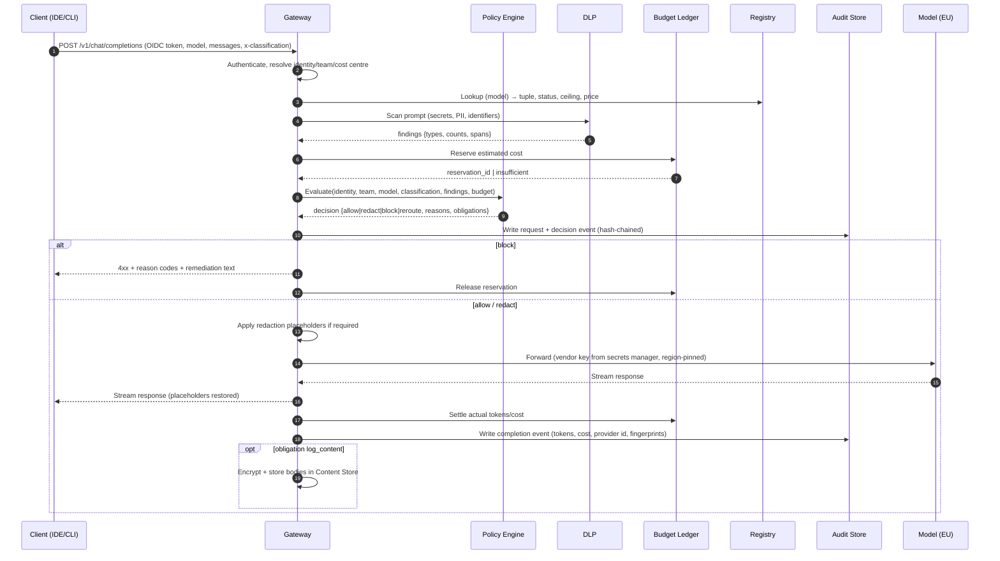
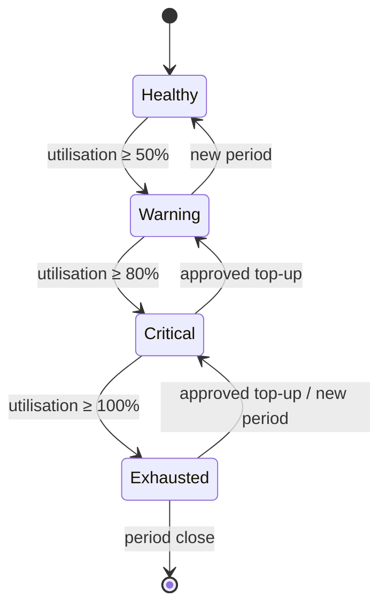
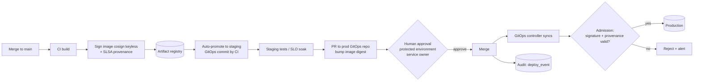

# 03 — App Flow Document

**Project:** AI Governance Layer (AGL)
**Status:** Draft v0.1
**Date:** 2026-10-19
**Related:** [01 PRD](01-product-requirements.md) · [02 TRD](02-technical-requirements.md) · [04 Design Brief](04-design-brief.md) · [05 Backend Schema](05-backend-schema.md)

This document walks through every flow a person, tool or system goes through with AGL. Each flow lists actors, preconditions, steps, decision points, what gets recorded, and failure behaviour. IDs (`F-xx`) are referenced by the schema and the implementation plan.

---

## F-01 Developer onboarding

**Actors:** Developer, Team Lead, IdP, Gateway, Admin Console.

1. Developer is added to an IdP group `ai-users-<team>` by the team lead (SCIM-synced).
2. Developer completes the AI literacy module (AI Act Art. 4) in the LMS; completion flag synced to IdP attribute `ai_training_completed`.
3. Developer installs the approved IDE plugin / CLI from the internal catalog. Configuration points at the gateway base URL; no API key is entered.
4. First request → OIDC device-code or browser flow → short-lived token (≤ 8 h) bound to the device.
5. Gateway resolves team, cost centre and role; creates `identity` row if new; writes `identity_created` audit event.

**Preconditions checked by policy:** group membership, training flag, device compliance claim (MDM) if available.
**Failure:** missing training → HTTP 403 with message "Complete AI literacy module at <link>" (see D-07 on in-band messages).

## F-02 Standard request (completion / chat)



**Decision points**

| Condition | Outcome |
|-----------|---------|
| Model not `approved`/`restricted` in registry | block, `MODEL_NOT_APPROVED` |
| Classification above model ceiling | block, `CLASSIFICATION_CEILING` |
| Secret detected | block, `SECRET_DETECTED`; security notified |
| PII detected, classification ≤ INTERNAL | redact + allow, `PII_REDACTED` |
| PII detected, classification CONFIDENTIAL | block unless model is zero-retention/self-hosted, else redact |
| Budget hard cap reached | block, `BUDGET_EXHAUSTED` |
| Budget ≥ soft threshold | allow + header `X-AGL-Warning: budget 85%` |
| Policy engine / ledger / audit unavailable | block, `GOVERNANCE_UNAVAILABLE` (fail closed) |

**Recorded:** `request`, `policy_decision`, `budget_event`(reserve/settle/release), `dlp_event` (types/counts only), optional content.

## F-03 Agentic session in sandbox

**Actors:** Developer, Sandbox Orchestrator, Agent CLI, Gateway, SCM, Audit Store.

1. Developer requests a sandbox for repo `X` from the platform portal/CLI.
2. Orchestrator checks repo classification manifest; RESTRICTED repos cannot get an AI sandbox.
3. Orchestrator provisions ephemeral container/VM: platform image, no cloud credentials, egress allowlist (gateway, package mirror, SCM), masked dataset mount if requested.
4. Orchestrator mints a delegated token `agent:claude-code on behalf of user:dana` scoped to: gateway, repo X read, push to `feature/*` only. Token expiry ≤ 8 h.
5. Agent runs. Every model call goes through F-02 with `client_type=agent`. Every tool call (shell, file write, MCP) is recorded locally and shipped as `agent_action` events.
6. Agent pushes a branch and may open a PR (draft). It cannot approve, merge, or trigger deploy workflows (SCM permission of the delegated token).
7. Session ends → sandbox destroyed → `sandbox_destroyed` event.

**Failure:** egress to a non-allowlisted host → connection refused + `egress_blocked` event. Attempt to use cloud CLI → no credentials present → fails; event recorded if the agent probes metadata endpoints.

## F-04 Budget threshold and top-up



1. Ledger emits `budget_threshold` at 50/80/100 % → notification to team channel and budget owner.
2. Team lead opens a **top-up request** in the console: amount, justification, expiry (≤ end of period).
3. Approver (budget owner / finance delegate, must differ from requester) approves or rejects.
4. On approval, ledger adds an `adjustment` line; `budget_exception` event written to audit store.
5. Requests blocked while exhausted return `BUDGET_EXHAUSTED` with a link to the request form.

**Kill switch:** security or platform admin can set a team or identity to `suspended`; gateway blocks immediately (`IDENTITY_SUSPENDED`).

## F-05 DLP block and remediation

1. Request blocked with `SECRET_DETECTED` or `RESTRICTED_DATA`.
2. Client shows: what *type* was found (e.g. "AWS access key pattern", "IBAN"), *not* the value; remediation: remove the data, use a placeholder, or raise the repo classification question with security.
3. Secret detections also create a security ticket automatically (possible real leak into the codebase or clipboard); on-call triages: rotate secret if confirmed real.
4. Repeated detections by the same identity (≥ 3 in 24 h) → team lead notified; training refresh assigned.
5. False positive → developer can flag it from the console; DLP rule owner tunes the rule via policy-as-code PR (itself reviewed).

**Recorded:** `dlp_event` (type, count, rule id, action), `ticket_ref`.

## F-06 Pull request with AI-assisted changes

```mermaid
sequenceDiagram
  autonumber
  actor Dev as Developer
  participant SCM as Git hosting
  participant CI as CI pipeline
  actor Rev as Reviewer (human, ≠ author)
  participant MQ as Merge queue
  participant A as Audit Store

  Dev->>SCM: Push signed commits with AI-Assisted trailer; open PR
  SCM->>SCM: Auto-label ai-assisted; require CODEOWNERS review for sensitive paths
  SCM->>CI: Trigger required checks
  CI->>CI: tests, SAST, secrets, SCA+license+SBOM, IaC policy, dependency allowlist, provenance
  CI-->>SCM: Status checks
  Rev->>SCM: Review (reads AI-assisted checklist), approve
  SCM->>SCM: Verify: ≥1 human approval ≠ author, no bot approval counted, signatures valid
  SCM->>MQ: Enqueue
  MQ->>CI: Re-run on merge candidate
  MQ->>SCM: Merge to main
  SCM->>A: merge_event (PR, commits, reviewers, labels, check results, attestation digest)
```

**AI-assisted review checklist** (shown in PR template when label present):

- [ ] I understand every line changed; I could explain it without the assistant.
- [ ] New dependencies exist on the allowlist / private registry and are the intended packages.
- [ ] No test was weakened or deleted to make CI pass.
- [ ] Security-sensitive paths (auth, crypto, payments, IaC) have a CODEOWNER approval.
- [ ] No production identifiers, hostnames or data appear in the diff.

**Failure:** missing label but assistant telemetry shows usage on the branch → check fails `AI_LABEL_MISSING`; author adds label. Bot approval → ignored by protection rule.

## F-07 Deployment to production



Rules enforced here: DEP-01..08 (TRD §6). The approval step cannot be satisfied by any CI/bot/AI identity; the environment's required reviewers list contains humans only, and is itself change-controlled.

**Rollback:** revert PR through the same path, or automated rollback to the previous digest on SLO breach (pre-approved runbook, logged as `deploy_event{type:rollback}`).

## F-08 Model / provider onboarding

| Step | Actor | Output |
|------|-------|--------|
| 1. Request | Engineering | Use case, data classification needed, expected volume |
| 2. Vendor assessment | Security + Procurement | Questionnaire: processing regions, sub-processors, retention, training opt-out, support access, certifications (ISO 27001, SOC 2), incident notification, exit |
| 3. Legal | Legal + DPO | DPA (Art. 28), SCCs/TIA if any non-EU access, AI Act provider obligations clause, indemnities |
| 4. DPIA (if personal data may be processed) | DPO | DPIA record |
| 5. Technical validation | Platform | Region pinning works; zero-retention flag verified; latency; API compatibility via gateway |
| 6. Registry entry `evaluating` → `approved` | Security admin + DPO (dual approval) | `registry_change` event |
| 7. Pricing loaded | FinOps | `price_list` rows |
| 8. Communication | Eng enablement | Announcement, docs update |
| Review | Security | Annual, or on vendor change notice; status may move to `restricted`/`deprecated`/`revoked` |

**Offboarding:** status `revoked` → gateway refuses; vendor data deletion confirmation requested; contract exit; event logged.

## F-09 Break-glass / exception

1. Requester opens exception: type (`model_enable`, `classification_override`, `budget_override`, `emergency_change`), scope, justification, duration (max 72 h).
2. Two approvers from the configured approver group (neither is requester); for `classification_override` one must be the DPO or deputy.
3. On approval, policy engine receives a signed, time-boxed `exception` input; gateway/CI honour it.
4. All requests made under the exception carry `exception_id` in audit events.
5. Expiry is automatic. Post-review within 5 working days; outcome recorded.

## F-10 Audit evidence export

1. Auditor selects date range and scope (team/model/event type) in the console.
2. System re-hashes the relevant segments from the WORM store, compares to anchors and RFC 3161 timestamps, and produces `verification_report` (pass/fail per segment).
3. Export package: JSONL events + report + registry snapshot + policy bundle versions in effect.
4. Export itself is logged (`evidence_export`).

## F-11 GDPR request against content store

1. DPO receives DSAR or erasure request concerning a subject (an employee, or a third party whose data may appear in prompts).
2. DPO searches the content store (not the audit store) via two-role access.
3. Erasure: records deleted or team key destroyed where whole-team scope; `content_erasure` event written to the immutable audit store (the audit store contains no personal content, only identities of employees as actors, which is retained under the legitimate interest / legal obligation basis documented in the DPIA).
4. Response to the subject compiled by DPO.

## F-12 Incident: suspected data leak via AI

1. Trigger: DLP secret detection confirmed real, or vendor notifies breach, or anomaly (unusual volume to one model).
2. On-call pulls audit events for identity/model/time; content store if available.
3. Containment: suspend identity or team (`IDENTITY_SUSPENDED`), or set model `restricted`, or revoke provider.
4. Vendor data deletion request if applicable; GDPR breach assessment (72 h clock) by DPO.
5. Post-incident: policy/DLP rule change via PR; lessons recorded.

## F-13 Policy change

1. Security engineer opens PR on `agl-policy` repo (Rego + tests + fixtures).
2. CI runs policy unit tests and a *replay* against last 7 days of anonymised decision inputs to show impact (how many allow→block etc.).
3. Review by second security engineer; DPO review required if classification rules change.
4. Merge → bundle signed → gateway hot-reloads → `policy_bundle_activated` event with digest.
5. Rollback = revert PR or pin previous bundle digest via admin API (logged).

## F-14 Quarterly isolation test

1. Scheduled job spins a sandbox and attempts: TCP to prod CIDRs, DNS for prod hostnames, cloud API calls with the agent identity, read of prod vault namespace.
2. All must fail. Results written as `isolation_test` events; any success → P1 incident.
3. IAM policy simulation: for every principal tagged `agent=true` and every AGL role, simulate production actions → must be denied.

## F-15 Monthly budget close

1. Ledger freezes the period; reconciles against vendor invoices (tolerance ± 2 %).
2. Variances investigated (price list drift, unmetered traffic → possible bypass).
3. Export per cost centre to finance; `period_closed` event.
