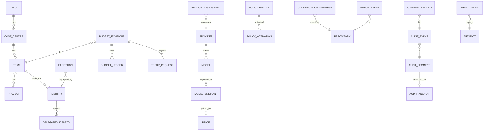

# 05 — Backend Schema Document

**Project:** AI Governance Layer (AGL)
**Status:** Draft v0.1
**Date:** 2026-10-19
**Related:** [02 TRD](02-technical-requirements.md) · [03 App Flows](03-app-flows.md)

---

## 1. Storage layout

AGL deliberately uses **three stores with different guarantees**:

| Store | Technology | Guarantee | Contains |
|-------|------------|-----------|----------|
| **Control plane DB** | PostgreSQL (EU region, managed or self-hosted), encrypted with EU KMS key | Transactional, mutable, versioned via history tables | Identities, teams, registry, budgets, policies, exceptions, vendors |
| **Audit store** | Object storage with Object Lock *compliance* mode (EU) + hot append-only Postgres table | Write-once, hash-chained, externally anchored | Events (no prompt text) |
| **Content store** | Object storage or Postgres, EU, per-team envelope encryption | Encrypted, short retention, erasable | Prompt/response bodies when policy allows |

Everything below is PostgreSQL 16 DDL unless noted. Naming: `snake_case`, singular table names, `id` as `uuid` (v7 preferred for time ordering), timestamps `timestamptz`, money as `numeric(14,6)` in EUR.

## 2. Entity-relationship overview



## 3. Control plane DB

### 3.1 Organisation and identity

```sql
create extension if not exists pgcrypto;
create extension if not exists btree_gist;   -- for the price date-range exclusion constraint

create type identity_kind as enum ('human','workload','agent');
create type identity_status as enum ('active','suspended','disabled');
create type role_name as enum (
  'developer','team_lead','budget_owner','security_admin',
  'dpo','auditor','platform_admin','finance'
);

create table org (
  id            uuid primary key default gen_random_uuid(),
  name          text not null,
  created_at    timestamptz not null default now()
);

create table cost_centre (
  id            uuid primary key default gen_random_uuid(),
  org_id        uuid not null references org(id),
  code          text not null,                 -- finance code
  name          text not null,
  unique (org_id, code)
);

create table team (
  id              uuid primary key default gen_random_uuid(),
  cost_centre_id  uuid not null references cost_centre(id),
  idp_group       text not null unique,        -- SCIM group name, e.g. ai-users-payments
  name            text not null,
  status          identity_status not null default 'active',
  created_at      timestamptz not null default now()
);

create table project (
  id        uuid primary key default gen_random_uuid(),
  team_id   uuid not null references team(id),
  key       text not null,                     -- e.g. PAY
  name      text not null,
  unique (team_id, key)
);

create table identity (
  id                   uuid primary key default gen_random_uuid(),
  kind                 identity_kind not null,
  subject              text not null unique,   -- OIDC sub / SPIFFE id
  display_name         text,
  email                text,                   -- personal data: employee; retention per HR policy
  team_id              uuid references team(id),
  status               identity_status not null default 'active',
  training_completed_at timestamptz,          -- AI Act Art. 4 literacy
  created_at           timestamptz not null default now(),
  updated_at           timestamptz not null default now()
);

create table identity_role (
  identity_id uuid not null references identity(id),
  role        role_name not null,
  scope_team  uuid references team(id),        -- null = org-wide
  granted_by  uuid references identity(id),
  granted_at  timestamptz not null default now(),
  primary key (identity_id, role, scope_team)
);

-- An agent run acting on behalf of a human (F-03)
create table delegated_identity (
  id              uuid primary key default gen_random_uuid(),
  principal_id    uuid not null references identity(id),   -- the human
  tool            text not null,                           -- 'claude-code', 'copilot-agent', ...
  sandbox_id      text not null,
  repository_id   uuid,                                    -- FK added after repository is created (§3.2)
  scopes          text[] not null,                         -- ['gateway','repo:read','repo:push:feature/*']
  issued_at       timestamptz not null default now(),
  expires_at      timestamptz not null,
  revoked_at      timestamptz,
  check (expires_at <= issued_at + interval '8 hours')
);
```

### 3.2 Repositories and classification

```sql
create type classification as enum ('PUBLIC','INTERNAL','CONFIDENTIAL','RESTRICTED');

create table repository (
  id            uuid primary key default gen_random_uuid(),
  scm_host      text not null,          -- github.example.com
  full_name     text not null,          -- org/repo
  team_id       uuid references team(id),
  classification classification not null default 'CONFIDENTIAL',  -- unlabelled defaults high
  manifest_sha  text,                   -- sha of .classification file
  ai_sandbox_allowed boolean not null generated always as (classification <> 'RESTRICTED') stored,
  ai_exposure   text not null default 'quarantined' check (ai_exposure in ('quarantined','allowed')),
  updated_at    timestamptz not null default now(),
  unique (scm_host, full_name)
);

alter table delegated_identity
  add constraint delegated_identity_repository_fk foreign key (repository_id) references repository(id);

-- Quarantine gate: the "certainties" that must hold before a repository may be exposed to AI (PoC PR-1).
-- One row per repository; ai_exposure may be 'allowed' only while every gate item is true and two distinct approvers are recorded.
create table repository_ai_gate (
  repository_id        uuid primary key references repository(id),
  classification_set   boolean not null default false,   -- G1
  no_prod_data         boolean not null default false,   -- G2 (no 'prod-derived' dataset attached)
  no_prod_secrets      boolean not null default false,   -- G3 (history secret scan clean)
  no_prod_connectivity boolean not null default false,   -- G4 (probe report)
  dpia_or_risk_ref     text,                             -- G5
  approver_security    uuid references identity(id),     -- G6
  approver_owner       uuid references identity(id),     -- G6
  approved_at          timestamptz,
  evidence             jsonb not null default '{}',      -- report URIs
  updated_at           timestamptz not null default now(),
  check (approver_security is null or approver_owner is null or approver_security <> approver_owner)
);

create or replace function enforce_ai_exposure() returns trigger language plpgsql as $$
declare g repository_ai_gate%rowtype;
begin
  if new.ai_exposure = 'allowed' then
    select * into g from repository_ai_gate where repository_id = new.id;
    if g.repository_id is null
       or not (g.classification_set and g.no_prod_data and g.no_prod_secrets and g.no_prod_connectivity)
       or g.approver_security is null or g.approver_owner is null
       or new.classification = 'RESTRICTED' then
      raise exception 'repository % cannot be exposed to AI: gate not satisfied', new.full_name;
    end if;
  end if;
  return new;
end $$;
create trigger repository_ai_exposure_guard before insert or update of ai_exposure, classification on repository
  for each row execute function enforce_ai_exposure();

-- Datasets that sandboxes may mount; anything prod-derived is never mountable
create table dataset (
  id            uuid primary key default gen_random_uuid(),
  name          text not null unique,
  origin        text not null check (origin in ('synthetic','masked','prod-derived')),
  masking_report_ref text,
  mountable     boolean not null generated always as (origin <> 'prod-derived') stored,
  repository_id uuid references repository(id),
  check (origin <> 'masked' or masking_report_ref is not null)
);
```

### 3.3 Providers, models, endpoints, prices

```sql
create type model_status as enum ('evaluating','approved','restricted','deprecated','revoked');
create type residency_class as enum ('EU_SELF_HOSTED','EU_PROVIDER_ZERO_RETENTION','EU_REGION_HYPERSCALER');

create table provider (
  id                 uuid primary key default gen_random_uuid(),
  name               text not null unique,            -- 'Azure OpenAI', 'Mistral', 'Self-hosted vLLM'
  legal_entity       text not null,                   -- contracting entity
  entity_country     char(2) not null,                -- ISO 3166-1
  parent_country     char(2),                         -- for TIA
  dpa_ref            text,                            -- document id
  scc_ref            text,
  tia_ref            text,
  training_opt_out   boolean not null default false,
  zero_retention     boolean not null default false,
  subprocessors      jsonb not null default '[]',
  exit_notice_days   int,
  next_review_at     date,
  created_at         timestamptz not null default now()
);

create table model (
  id            uuid primary key default gen_random_uuid(),
  provider_id   uuid not null references provider(id),
  name          text not null,                 -- 'claude-sonnet-x', 'mistral-large-y'
  version       text not null,
  modality      text[] not null default '{text}',
  unique (provider_id, name, version)
);

create table model_endpoint (
  id              uuid primary key default gen_random_uuid(),
  model_id        uuid not null references model(id),
  alias           text not null unique,         -- what clients request: 'code-default'
  base_url        text not null,
  region          text not null,                -- 'swedencentral', 'eu-central-1', 'fr-par'
  region_country  char(2) not null,
  residency       residency_class not null,
  status          model_status not null default 'evaluating',
  classification_ceiling classification not null default 'INTERNAL',
  cost_tier       smallint not null default 2,  -- 1 cheap .. 4 premium
  context_window  int,
  approved_by_security uuid references identity(id),
  approved_by_dpo      uuid references identity(id),
  approved_at     timestamptz,
  next_review_at  date,
  owner_identity  uuid references identity(id),
  secret_ref      text not null,                -- path in secrets manager, never the key
  check (region_country in ('AT','BE','BG','HR','CY','CZ','DK','EE','FI','FR','DE','GR','HU','IE','IT','LV','LT','LU','MT','NL','PL','PT','RO','SK','SI','ES','SE','NO','IS','LI','CH')),
  check (status not in ('approved','restricted') or (approved_by_security is not null and approved_by_dpo is not null and approved_by_security <> approved_by_dpo))
);

create table price (
  id                 uuid primary key default gen_random_uuid(),
  model_endpoint_id  uuid not null references model_endpoint(id),
  effective_from     date not null,
  effective_to       date,
  input_per_1m_eur   numeric(14,6) not null,
  output_per_1m_eur  numeric(14,6) not null,
  cached_input_per_1m_eur numeric(14,6),
  source             text not null,             -- 'contract', 'list price'
  exclude using gist (model_endpoint_id with =, daterange(effective_from, coalesce(effective_to,'infinity'::date), '[)') with &&)
);
```

Note: the `region_country` check is a *guard rail*, not the legal test. EEA/CH countries are included because adequacy applies; the legal team decides the final list and the check is updated by migration.

### 3.4 Vendor assessments and SaaS AI inventory

```sql
create type assessment_outcome as enum ('pending','approved','approved_with_conditions','rejected');

create table vendor_assessment (
  id              uuid primary key default gen_random_uuid(),
  provider_id     uuid references provider(id),
  saas_product    text,                          -- for embedded AI features without a gateway path
  assessed_by     uuid not null references identity(id),
  questionnaire   jsonb not null,                -- answers
  certifications  text[] not null default '{}',  -- ['ISO27001','SOC2']
  dpia_ref        text,
  outcome         assessment_outcome not null default 'pending',
  conditions      text,
  assessed_at     timestamptz not null default now(),
  valid_until     date not null
);

create table saas_ai_feature (
  id             uuid primary key default gen_random_uuid(),
  product        text not null,
  feature        text not null,
  data_touched   classification not null,
  enabled        boolean not null default false,
  assessment_id  uuid references vendor_assessment(id),
  owner_identity uuid references identity(id),
  unique (product, feature)
);
```

### 3.5 Budgets

```sql
create type envelope_scope as enum ('org','cost_centre','team','project','identity');
create type ledger_kind as enum ('reserve','settle','release','adjustment','period_open','period_close');

create table budget_envelope (
  id             uuid primary key default gen_random_uuid(),
  scope          envelope_scope not null,
  scope_id       uuid not null,                  -- id in the corresponding table
  period_start   date not null,
  period_end     date not null,
  amount_eur     numeric(14,2) not null check (amount_eur >= 0),
  daily_cap_eur  numeric(14,2),
  soft_pct       smallint[] not null default '{50,80}',
  owner_identity uuid not null references identity(id),
  status         text not null default 'open' check (status in ('open','closed')),
  unique (scope, scope_id, period_start)
);

create table budget_ledger (
  id               uuid primary key default gen_random_uuid(),
  envelope_id      uuid not null references budget_envelope(id),
  kind             ledger_kind not null,
  amount_eur       numeric(14,6) not null,        -- positive = consumption, negative = credit/release
  request_id       uuid,                          -- audit event id of the gateway request
  reservation_id   uuid,
  identity_id      uuid references identity(id),
  model_endpoint_id uuid references model_endpoint(id),
  input_tokens     int,
  output_tokens    int,
  cached_tokens    int,
  created_at       timestamptz not null default now()
);
create index on budget_ledger (envelope_id, created_at);

-- Materialised utilisation; refreshed by trigger or every 10 s
create materialized view budget_utilisation as
select e.id as envelope_id, e.amount_eur,
       coalesce(sum(l.amount_eur) filter (where l.kind in ('reserve','settle','adjustment')),0) as consumed_eur
from budget_envelope e left join budget_ledger l on l.envelope_id = e.id
group by e.id;

create table topup_request (
  id             uuid primary key default gen_random_uuid(),
  envelope_id    uuid not null references budget_envelope(id),
  requested_by   uuid not null references identity(id),
  amount_eur     numeric(14,2) not null check (amount_eur > 0),
  justification  text not null check (length(justification) >= 50),
  expires_at     timestamptz not null,
  status         text not null default 'open' check (status in ('open','approved','rejected','expired')),
  decided_by     uuid references identity(id),
  decided_at     timestamptz,
  decision_note  text,
  created_at     timestamptz not null default now(),
  check (decided_by is null or decided_by <> requested_by)
);
```

Reservation accounting: a `reserve` line is written at request start with an estimate (input tokens × price + max_output × price). On completion a `settle` line records actual minus reserve. Expired reservations (> 10 min without settle) get a `release` line from a sweeper.

### 3.6 Policy bundles and exceptions

```sql
create table policy_bundle (
  id          uuid primary key default gen_random_uuid(),
  digest      text not null unique,             -- sha256 of signed bundle
  git_commit  text not null,
  signature   text not null,
  created_by  uuid not null references identity(id),
  created_at  timestamptz not null default now()
);

create table policy_activation (
  id          uuid primary key default gen_random_uuid(),
  bundle_id   uuid not null references policy_bundle(id),
  activated_by uuid not null references identity(id),
  activated_at timestamptz not null default now(),
  deactivated_at timestamptz
);

create type exception_type as enum ('model_enable','classification_override','budget_override','emergency_change');

create table exception (
  id             uuid primary key default gen_random_uuid(),
  type           exception_type not null,
  scope          jsonb not null,                 -- {team_id, model_endpoint_id, repository_id, ...}
  justification  text not null,
  requested_by   uuid not null references identity(id),
  approver_1     uuid references identity(id),
  approver_2     uuid references identity(id),
  approved_at    timestamptz,
  starts_at      timestamptz,
  ends_at        timestamptz,
  status         text not null default 'open' check (status in ('open','approved','rejected','expired','closed')),
  post_review_at timestamptz,
  post_review_note text,
  created_at     timestamptz not null default now(),
  check (ends_at is null or ends_at <= starts_at + interval '72 hours'),
  check (approver_1 is null or approver_1 <> requested_by),
  check (approver_2 is null or (approver_2 <> requested_by and approver_2 <> approver_1))
);
```

### 3.7 History tables

Every control-plane table has a `_history` twin populated by a generic trigger (`row_to_jsonb(OLD)`, operation, actor, timestamp). History tables are INSERT-only for the application role. In addition, each change emits an audit event (`registry_change`, `budget_change`, …) to the audit store, so the immutable record does not depend on the control-plane DB.

## 4. Audit store

### 4.1 Event envelope (JSON, stored in WORM segments)

```json
{
  "event_id": "018f6b2e-....",
  "ts": "2026-10-19T09:12:33.120Z",
  "type": "request",
  "schema_version": 1,
  "actor": {
    "identity_id": "…", "kind": "agent", "principal_id": "…",
    "team_id": "…", "cost_centre": "CC-204", "client_type": "cli", "sandbox_id": "sbx-…"
  },
  "model": {
    "endpoint_id": "…", "alias": "code-default", "provider": "Mistral",
    "name": "mistral-large", "version": "2026-06", "region": "fr-par", "residency": "EU_PROVIDER_ZERO_RETENTION"
  },
  "classification": { "declared": "INTERNAL", "effective": "INTERNAL", "source": "repo_manifest" },
  "dlp": { "findings": [{"type":"EMAIL","count":2,"rule":"pii.email.v3"}], "action": "redact" },
  "decision": { "outcome": "allow", "reasons": ["PII_REDACTED"], "bundle_digest": "sha256:…", "exception_id": null,
                "obligations": {"log_content": true} },
  "usage": { "input_tokens": 1830, "output_tokens": 412, "cached_tokens": 0, "cost_eur": 0.0071,
             "reservation_id": "…", "provider_request_id": "…" },
  "fingerprints": { "prompt_sha256": "…", "response_sha256": "…" },
  "trace_id": "…",
  "prev_hash": "sha256:…",
  "hash": "sha256:…"
}
```

`hash = sha256(canonical_json(event without hash) || prev_hash)`. Canonicalisation per RFC 8785 (JCS).

Event `type` values: `request`, `completion`, `policy_decision`, `dlp_event`, `budget_event`, `budget_exception`, `identity_created`, `identity_suspended`, `registry_change`, `vendor_assessment`, `policy_bundle_activated`, `exception_*`, `agent_action`, `sandbox_created`, `sandbox_destroyed`, `egress_blocked`, `merge_event`, `deploy_event`, `isolation_test`, `content_access`, `content_erasure`, `evidence_export`, `period_closed`, `admin_action`.

### 4.2 Segments and anchors

```sql
-- Hot copy; source of truth is the object store
create table audit_event (
  event_id     uuid primary key,
  ts           timestamptz not null,
  type         text not null,
  actor_identity_id uuid,
  team_id      uuid,
  model_endpoint_id uuid,
  outcome      text,
  reasons      text[],
  cost_eur     numeric(14,6),
  segment_id   uuid not null,
  prev_hash    text not null,
  hash         text not null,
  body         jsonb not null
);
create index on audit_event (ts);
create index on audit_event (team_id, ts);
create index on audit_event (type, ts);

create table audit_segment (
  id            uuid primary key,
  started_at    timestamptz not null,
  closed_at     timestamptz,
  object_uri    text,                   -- s3://agl-audit-eu/2026/10/19/seg-….jsonl.zst
  first_event   uuid,
  last_event    uuid,
  event_count   int,
  first_hash    text,
  last_hash     text,
  object_lock_until timestamptz          -- retention per legal (default now()+24 months)
);

create table audit_anchor (
  id             uuid primary key,
  anchor_date    date not null unique,
  root_hash      text not null,          -- hash of all segment last_hashes of the day
  external_uri   text not null,          -- second provider / on-prem
  tsa_token      bytea,                  -- RFC 3161 timestamp token
  signed_by      text not null,          -- HSM key id
  created_at     timestamptz not null default now()
);

create table chain_verification (
  id          uuid primary key default gen_random_uuid(),
  range_start timestamptz not null,
  range_end   timestamptz not null,
  run_by      uuid references identity(id),
  run_at      timestamptz not null default now(),
  result      text not null check (result in ('pass','fail')),
  details     jsonb not null
);
```

### 4.3 Append-only enforcement in Postgres

```sql
create role agl_audit_writer noinherit;
grant insert on audit_event, audit_segment, audit_anchor to agl_audit_writer;
revoke update, delete, truncate on audit_event, audit_segment, audit_anchor from public, agl_audit_writer;

create or replace function deny_mutation() returns trigger language plpgsql as $$
begin
  raise exception 'audit tables are append-only (%.% %)', tg_table_schema, tg_table_name, tg_op;
end $$;

create trigger audit_event_no_mutation   before update or delete or truncate on audit_event   for each statement execute function deny_mutation();
create trigger audit_segment_no_mutation before update or delete or truncate on audit_segment for each statement execute function deny_mutation();
create trigger audit_anchor_no_mutation  before update or delete or truncate on audit_anchor  for each statement execute function deny_mutation();
```

(`audit_segment.closed_at` and friends are set by inserting the final row; segments are created closed, i.e. the writer inserts the segment row only after the object is sealed.) Superuser access to this database is restricted and itself logged; the WORM object store is the record that an auditor relies on, not this table.

### 4.4 Retention and legal hold

- Object Lock compliance mode with retention = `audit_retention_months` (default 24). Legal hold flag can extend indefinitely.
- After retention, a scheduled job deletes objects and writes `audit_pruned` summary events (count, range) into the current chain so the gap is explained.

## 5. Content store

```sql
create table content_record (
  id              uuid primary key,
  event_id        uuid not null,                 -- references audit_event logically (no FK across stores)
  team_id         uuid not null,
  key_id          text not null,                 -- KMS data key id (per team)
  prompt_cipher   bytea,
  response_cipher bytea,
  prompt_sha256   text not null,                 -- must equal audit fingerprint
  response_sha256 text,
  created_at      timestamptz not null default now(),
  expires_at      timestamptz not null,          -- default now()+30 days
  erased_at       timestamptz,
  erased_by       uuid,
  erasure_event_id uuid
);
create index on content_record (team_id, created_at);
create index on content_record (expires_at) where erased_at is null;
```

Access requires two roles; every read emits `content_access` to the audit store. Erasure is a soft-delete plus ciphertext overwrite, or team-key destruction for bulk; both emit `content_erasure`.

## 6. Change-governance records

```sql
create table merge_event (
  id               uuid primary key,
  repository_id    uuid not null references repository(id),
  pr_number        int not null,
  merge_commit     text not null,
  author_identity  uuid references identity(id),
  ai_assisted      boolean not null,
  ai_tools         text[] not null default '{}',
  reviewers        uuid[] not null,               -- human identities
  approvals_human  int not null,
  approvals_bot_ignored int not null default 0,
  checks           jsonb not null,                -- {name: status}
  sbom_digest      text,
  provenance_digest text,
  merged_at        timestamptz not null,
  audit_event_id   uuid not null,
  check (approvals_human >= 1),
  check (not (author_identity = any(reviewers)))
);

create table artifact (
  id              uuid primary key,
  repository_id   uuid not null references repository(id),
  merge_event_id  uuid references merge_event(id),
  kind            text not null,                   -- 'oci','package'
  digest          text not null unique,
  signature_ref   text not null,                   -- Rekor entry / cosign bundle
  provenance_ref  text not null,
  builder_identity text not null,                  -- CI OIDC subject
  built_at        timestamptz not null
);

create table deploy_event (
  id              uuid primary key,
  artifact_id     uuid not null references artifact(id),
  environment     text not null check (environment in ('dev','staging','production')),
  type            text not null check (type in ('deploy','rollback')),
  gitops_commit   text not null,
  approved_by     uuid references identity(id),    -- must be human for production
  approver_kind   identity_kind,
  admitted_at     timestamptz,
  admission_result text check (admission_result in ('admitted','rejected')),
  exception_id    uuid references exception(id),
  audit_event_id  uuid not null,
  check (environment <> 'production' or (approved_by is not null and approver_kind = 'human'))
);

create table isolation_test (
  id          uuid primary key,
  run_at      timestamptz not null default now(),
  probes      jsonb not null,            -- [{probe:'tcp prod-cidr', expected:'fail', actual:'fail'}]
  passed      boolean not null,
  audit_event_id uuid not null
);
```

## 7. Roles and grants (summary)

| DB role | Control plane | Audit hot copy | Content store |
|---------|---------------|----------------|---------------|
| `agl_gateway` | select on registry, budgets; insert ledger | insert | insert |
| `agl_admin_api` | CRUD with history triggers | insert | none |
| `agl_console_ro` | select | select | none (content via API with 2-role check) |
| `agl_audit_writer` | none | insert | none |
| `agl_verifier` | none | select | none |
| `agl_dpo_api` | select identity | select | select + erase (logged) |

No role has UPDATE/DELETE on audit tables. Migrations run via a dedicated role in CI with the migration itself recorded as `admin_action`.

## 8. Data retention summary

| Data | Retention | Basis |
|------|-----------|-------|
| Audit events (WORM) | 24 months default, legal hold possible | Legal obligation / legitimate interest (ISO 27001 A.5.33) |
| Content records | 30 days default; opt-in per team; erasable | Legitimate interest (quality/debug); DPIA |
| Budget ledger | 10 years (financial records) | Legal obligation |
| Identity | Employment + 12 months | HR policy |
| DLP finding types/counts | with audit events | as above |
| Agent action logs | 12 months | Security monitoring |

## 9. Open schema questions

- Per-identity envelopes (Q4): schema supports it via `envelope_scope='identity'`; decide whether to populate.
- Whether `audit_event.body` should hold the full envelope or only indexed fields (storage vs convenience); default full for 90 days, then indexed-only.
- Multi-org support: tables carry `org_id` at the root only; add to `team` if multiple legal entities need separation.
