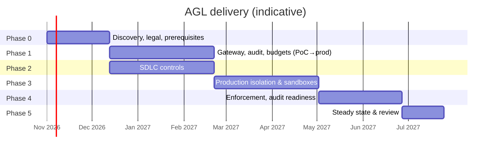

# 06 — Implementation Plan

**Project:** AI Governance Layer (AGL)
**Status:** Draft v0.1
**Date:** 2026-10-19
**Related:** [01 PRD](01-product-requirements.md) · [02 TRD](02-technical-requirements.md) · [03 App Flows](03-app-flows.md) · [05 Backend Schema](05-backend-schema.md) · [Decision Log](decision-log.md)

---

## 1. Approach

Deliver in five phases over roughly 9 months. Phases 1–3 each end with something enforceable in production of the *governance layer* (never in the company's production systems). Controls are introduced in **observe → warn → enforce** mode so that developers are not blocked by surprise and so that false positives are tuned before they bite.

## 2. Phase 0 — Discovery and prerequisites (≈ 6 weeks)

**Goal:** know the legal envelope, the current AI footprint, and whether the environment can support isolation.

| # | Deliverable | Owner | Acceptance |
|---|-------------|-------|------------|
| 0.1 | Regulatory scoping memo: GDPR, AI Act (deployer obligations, Art. 4 literacy), NIS2/DORA applicability, retention periods | Legal + DPO | Signed memo; answers PRD Q1, Q2 |
| 0.2 | AI footprint inventory: tools in use, SaaS-embedded AI, spend on cards, direct API keys | Security + FinOps | Inventory sheet; egress logs analysed |
| 0.3 | Data classification scheme confirmed; repo manifest format defined; default classification agreed | Security | Standard published |
| 0.4 | Environment separation check: separate prod accounts/subscriptions? network routes? vault namespaces? | Platform | Gap list; remediation tickets if any |
| 0.5 | AI Acceptable Use Policy v1 + AI Governance Standard draft, aligned to ISO 42001 clause structure | CISO | Approved by management; added to ISMS |
| 0.6 | Risk register entries and Statement of Applicability update plan | ISMS owner | Reviewed |
| 0.7 | Vendor shortlist and assessment questionnaire; initiate assessments for 2 providers (one hyperscaler EU, one EU-native) | Procurement + Security | Questionnaires sent |
| 0.8 | Choice of SCM/CI stack confirmed (PRD Q5); GitOps tool confirmed | Platform | Decision recorded |
| 0.9 | Team staffed: product owner, 2 platform engineers, 1 security engineer, part-time DPO/legal, FinOps | Management | Named |

**Exit criteria:** 0.1, 0.3, 0.4 (no blocking gaps), 0.5 approved.

## 3. Phase 1 — Runtime governance core (≈ 10 weeks)

**Goal:** a working gateway in an EU region with identity, registry, audit chain and budgets; two approved models; 2 pilot teams.

| # | Deliverable | Acceptance |
|---|-------------|------------|
| 1.1 | **Spike (2 weeks):** evaluate 2 OSS gateways against T-GW-01..10; pick one (D-06) | Spike report; decision |
| 1.2 | Infra: EU K8s/VM cluster for AGL, EU Postgres, EU object storage with Object Lock, EU KMS, secrets manager | Terraform in Git; region asserted by policy-as-code |
| 1.3 | Gateway deployed with OIDC (humans) and workload identity (services); OpenAI- and Anthropic-compatible surfaces | IDE plugin and CLI work via base-URL change |
| 1.4 | Model registry + admin API with dual approval | 2 endpoints approved (F-08 completed for 2 vendors) |
| 1.5 | Audit store: event envelope, hash chain, hourly segments to Object Lock, daily anchor to second store + RFC 3161; verification tool | Verification passes on 7 consecutive days; tamper test (attempt delete) fails |
| 1.6 | Budget ledger with reserve/settle, envelopes, thresholds, top-up flow (console or CLI) | Pilot team hits soft threshold in test; hard cap blocks |
| 1.7 | Policy engine (OPA) with initial bundle: registry status, ceiling, budget; policy repo with CI tests | Decisions logged; replay harness works |
| 1.8 | DLP v1: secrets + basic PII, mode = **observe** (log only) | Findings visible in console; false-positive rate measured |
| 1.9 | Console v1: overview, spend, requests explorer, registry, event detail | Pilot leads can self-serve |
| 1.10 | Pilot with 2 teams (≈ 30 developers) | ≥ 80 % of their AI traffic via gateway; satisfaction survey |
| 1.11 | SIEM integration; alerts for governance-unavailable and audit-write failure | Alerts tested |
| 1.12 | DPIA for the gateway itself (it processes employee identifiers and may store content) | DPIA signed |

**Exit criteria:** chain verified, budgets enforce, pilots live, DPIA done.

## 4. Phase 2 — Change governance (≈ 10 weeks, parallel with Phase 1 after 0.8)

**Goal:** every merge and every production deploy in the pilot repos carries the controls in TRD §5–6.

| # | Deliverable | Acceptance |
|---|-------------|------------|
| 2.1 | Branch protection baseline as code (signed commits, required checks, ≥ 1 human review, no bot approvals, linear history) applied to pilot repos | Settings exported and diffed in CI |
| 2.2 | `ai-assisted` detection: commit trailer convention + auto-label action; telemetry cross-check (observe mode) | Labels appear; mismatch report |
| 2.3 | CI gates as reusable workflow: tests, SAST, secret scan, SCA + license + SBOM, IaC policy, dependency allowlist check | Gates required on pilot repos |
| 2.4 | Artifact signing (cosign keyless) + SLSA provenance in CI | Attestations verifiable |
| 2.5 | Admission control in staging then production clusters: signature + provenance from allowed CI identity | Unsigned image rejected in test |
| 2.6 | GitOps production path with protected environment and human-only required reviewers; CI identity excluded | Test: bot approval ignored; CI cannot approve prod |
| 2.7 | Evidence publisher: merge and deploy events → audit store | Events visible with digests |
| 2.8 | PR template with AI-assisted checklist; CODEOWNERS for sensitive paths | Present in pilot repos |
| 2.9 | Developer guide "Working with AI assistants under AGL" | Published |

**Exit criteria:** pilot repos cannot merge without controls; production deploy requires human approval and admitted only when signed.

## 5. Phase 3 — Production isolation and agent sandboxes (≈ 10 weeks)

**Goal:** prove, continuously, that AI tooling cannot reach production; make agentic tools usable safely.

| # | Deliverable | Acceptance |
|---|-------------|------------|
| 3.1 | IAM guardrails: SCP / Azure Policy / Org Policy denying `agent=true` principals and AGL roles in production scopes | Policy simulation shows deny |
| 3.2 | Network: AGL and sandbox networks with no route to prod; egress allowlist | Reachability test fails as expected |
| 3.3 | Masked-data pipeline and catalog (A.8.11, A.8.33): synthetic/pseudonymised datasets for the pilot domains | Datasets tagged; no prod restores into non-prod (detective control) |
| 3.4 | Sandbox orchestrator: ephemeral environments, delegated identities (≤ 8 h), allowlisted MCP servers, agent action logging | F-03 end-to-end for Claude Code or equivalent |
| 3.5 | Quarterly isolation test automated (F-14) | First run recorded |
| 3.6 | Egress blocks for non-gateway AI endpoints on corporate network and devices (DNS/proxy/CASB), in warn mode | Bypass rate measured |
| 3.7 | Content store (optional, per Q7) with per-team keys, 2-role access, erasure flow | F-11 tested |

**Exit criteria:** isolation test passes; sandboxes in use by pilot teams.

## 6. Phase 4 — Enforcement and audit readiness (≈ 8 weeks)

| # | Deliverable | Acceptance |
|---|-------------|------------|
| 4.1 | DLP to **enforce** (block secrets, redact PII) after tuning; false-positive flag flow | FP rate < 2 % on sample |
| 4.2 | Egress blocks to **enforce**; direct vendor keys revoked; card subscriptions cancelled | < 1 % bypass |
| 4.3 | Roll out to all engineering teams; budgets for all cost centres | 100 % teams with envelopes |
| 4.4 | Branch protection + gates on all repositories in scope | Compliance report 100 % |
| 4.5 | Exceptions / break-glass flow (F-09) live | Dry run completed |
| 4.6 | AI literacy training completed by all AI users; gate enforced at login | ≥ 95 % |
| 4.7 | Evidence export (F-10); internal audit of AI scope; SoA updated | No major nonconformity |
| 4.8 | Pen test of gateway and console | Findings closed or accepted |
| 4.9 | Vendor annual review calendar; registry review dates | Scheduled |

## 7. Phase 5 — Steady state (ongoing)

- Monthly: budget close (F-15), spend review, model/price updates.
- Quarterly: isolation test, access review, policy replay review, DLP tuning.
- Annually: vendor reassessments, DPIA refresh, pen test, management review input, consider ISO 42001 certification.

## 8. Options to decide during the plan

| Decision | When | Options | Leaning |
|----------|------|---------|---------|
| Gateway implementation | Phase 1.1 | LiteLLM / Envoy AI Gateway / Kong | Spike decides (D-06) |
| Self-hosted model tier | end Phase 1 | Yes (GPU on EU IaaS) / No (block CONFIDENTIAL from AI) | Decide on pilot demand (Q3) |
| Content logging | Phase 3.7 | On for INTERNAL opt-in / Off entirely | Off by default, opt-in |
| Per-identity budgets | Phase 1.6 | Team only / Team + identity daily cap | Team envelope + identity daily cap (runaway protection) |
| IDE tools that cannot use custom base URL | Phase 0.2 | Allow enterprise tier with EU residency / Prohibit | Allow only with assessment + SSO + exclusions; prefer gateway-capable tools |

## 9. Team and RACI

| Activity | Product owner | Platform eng | Security eng | DPO/Legal | FinOps | Team leads |
|----------|---------------|--------------|--------------|-----------|--------|------------|
| Gateway, infra | A | R | C | I | I | I |
| Policy bundle | C | C | R/A | C | I | I |
| Registry / vendors | C | C | R | A | C | I |
| Budgets | C | R | I | I | A | C |
| SDLC controls | C | R | A | I | I | C |
| Isolation | I | R | A | I | I | I |
| Training | A | I | R | C | I | R |
| Audit evidence | C | C | R | A | I | I |

## 10. Risks and mitigations

| Risk | Likelihood | Impact | Mitigation |
|------|------------|--------|------------|
| Developers bypass the gateway because it is slower or worse | Med | High | Approve good models early; measure latency; enforce egress only after the approved path is clearly usable |
| Vendor residency claims do not hold up in TIA | Med | High | Two providers from day one; self-hosted option as fallback |
| False positives in DLP block legitimate work | High initially | Med | Observe → warn → enforce; flag flow; tuned rule sets |
| IDE vendors do not support custom endpoints | Med | Med | Treat as SaaS-embedded; enterprise tier with residency; or replace tool |
| Environment separation gaps (shared accounts) | Med | High | Phase 0.4 gate; remediation before Phase 3 |
| Audit store cost growth | Low | Low | Compress segments; indexed-only body after 90 days |
| Policy complexity grows unmanaged | Med | Med | Policy repo with tests, owners, replay; quarterly review |
| Agent prompt injection leads to malicious PR | Med | Med | Sandbox, human review, dependency allowlist, CODEOWNERS |
| Project treated as "security says no" | Med | High | Product owner from engineering; developer satisfaction metric; fast exception path |

## 11. Indicative cost envelope (to be refined in Phase 0)

| Item | Order of magnitude / year |
|------|---------------------------|
| AGL infrastructure (gateway HA, Postgres, object storage, KMS, EU region) | low tens of k€ |
| Model consumption (500 devs, mixed) | mid-to-high hundreds of k€ — the dominant cost; the budget system exists to shape this |
| Optional self-hosted GPU tier | tens to low hundreds of k€ depending on model size and utilisation |
| Tooling (SAST/SCA licences if not already owned, timestamping, pen test) | tens of k€ |
| People (team in §2 0.9) | the largest fixed cost |

## 12. Definition of done for the programme

1. Every AI request from company devices and non-prod workloads passes through the gateway, is policy-evaluated, metered, and immutably logged.
2. Only EU-resident, assessed, dual-approved model endpoints are reachable.
3. Budgets are enforced in real time with a logged exception path.
4. No code reaches `main` without a human review distinct from the author and green CI gates; AI-assisted changes are labelled.
5. No artifact reaches production unless signed by CI, provenance-attested, human-approved, and admitted by policy.
6. No AI identity holds production permissions; no network path exists; proven quarterly.
7. Internal audit has sampled the evidence through the export flow and verified the hash chain.
