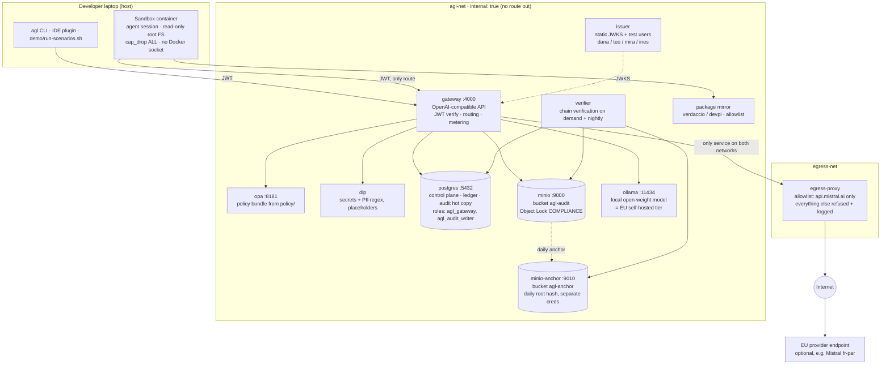
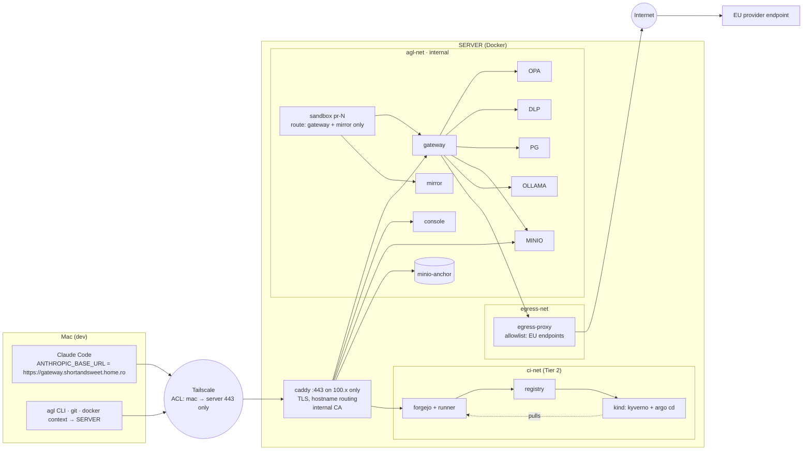

# 07 — Proof of Concept Requirements

**Project:** AI Governance Layer (AGL)
**Status:** Draft v0.1
**Date:** 2026-10-19
**Related:** [02 TRD](02-technical-requirements.md) · [03 App Flows](03-app-flows.md) · [05 Backend Schema](05-backend-schema.md) · [06 Implementation Plan](06-implementation-plan.md)

---

## 1. Purpose

Show, on a laptop, that the governance model in the TRD works end to end: one door for AI traffic, EU-only routing, DLP, hard budgets, an audit log that cannot be altered, and a merge/deploy path where only humans approve and AI never reaches production. The PoC exists to de-risk decisions D-01, D-04, D-05, D-08 and D-09 and to give stakeholders something to see before Phase 1.

The PoC is **not** a production system. It uses stand-ins for identity, models and infrastructure where noted.

## 1.1 The four proofs

The PoC is judged on four statements. Everything else in this document exists to make these demonstrable.

| Proof | Statement | Demonstrated by |
|-------|-----------|-----------------|
| **PR-1 Quarantine** | A named application repository is **not exposed to AI at all** (no code, no database, nothing derived from production) until a defined set of certainties is met and signed off. Until then every path is closed: gateway, agent sandbox, dataset mounts, CI AI steps. After sign-off, only the approved, non-production material is exposed. | S19–S23, P-18, P-19 |
| **PR-2 Total budget** | An **organisation-wide total** cannot be exceeded, independent of team envelopes. When the total is reached, every request is blocked, and only a logged, dual-approved adjustment re-opens it. | S8, S9, S24, P-06, P-20 |
| **PR-3 EU only** | **No detail leaves the EU.** Non-EU endpoints cannot be registered, cannot be selected by policy, and cannot be reached from the gateway network even if someone tries to bypass the registry. | S14, S25, S26, P-03, P-21 |
| **PR-4 Immutable** | The record of what happened **cannot be altered or deleted** by anyone, including administrators, and any attempt is detectable. | S10–S12, P-07–P-10 |

### Quarantine gate — the "certainties" checklist (PR-1)

A repository starts in `ai_exposure = quarantined`. It moves to `allowed` only when all gate items are true and two approvers (security + application owner, neither the requester) sign off. The gate is data in the control plane, evaluated by policy on every request, so a missing item re-closes the door automatically.

| Gate item | What must be true | Evidence in PoC |
|-----------|-------------------|-----------------|
| G1 Classification set | `.classification` manifest present and ≤ CONFIDENTIAL | Manifest file in demo repo |
| G2 No production data | No dataset tagged `prod-derived` is mountable; only catalog entries tagged `synthetic` or `masked` with a masking report | Catalog table rows |
| G3 No production secrets | Secret scan of the repository history is clean; no production vault paths referenced | Scan report artefact |
| G4 No production connectivity | Sandbox image for this repo has no prod CIDRs/hostnames reachable; probe report attached | Probe output |
| G5 DPIA / risk acceptance | DPIA reference recorded if personal data could appear; risk owner named | Registry fields |
| G6 Dual sign-off | Two distinct approvers recorded with timestamp | `repository_ai_gate` row |

If any gate item is later invalidated (for example a `prod-derived` dataset is tagged on the repo, or the manifest is removed), `ai_exposure` returns to `quarantined` and the next request is blocked with `REPO_QUARANTINED`.

## 2. Scope

| Tier | Included | Effort |
|------|----------|--------|
| **Tier 1 (required)** | Gateway, policy engine, DLP, budget ledger, model registry, hash-chained WORM audit store, chain verifier, scripted demo | ~1 day |
| **Tier 2 (optional)** | Demo repository with branch protection, AI-assisted labelling, CI gates, artifact signing, admission control, human-only production approval, one-page console | +2–3 days |
| Out of scope | Sandbox orchestrator, Presidio-grade PII, real IdP, RFC 3161 timestamps, SIEM, content store, SaaS-AI inventory | Phase 1–3 |

## 3. Prerequisites (what we need before starting)

### 3.1 Tier 1

| Item | Requirement | Why |
|------|-------------|-----|
| Machines | SERVER (PC, Linux, Docker Engine + Compose v2, 8 CPU, 16 GB RAM, 40 GB free) runs the stack; a Mac is the developer machine; both on the same Tailscale tailnet; DNS for `shortandsweet.home.ro` on SERVER. See §10.5 | Separates the developer from the governance stack by a real network |
| Local model | Ollama with a small coding model (e.g. 7–8 B parameters, ~5 GB) **or** a mock model service | Stands in for the self-hosted EU tier; mock keeps the demo deterministic |
| Optional EU provider key | One API key for an EU-region endpoint (e.g. Mistral La Plateforme, Azure OpenAI in an EU region) | Shows a real provider behind the same door; not required |
| Ports | 4000 (gateway), 8181 (OPA), 5432 (Postgres), 9000/9001 (MinIO), 11434 (Ollama) free | Compose networking |
| Data | None. All prompts in the demo are synthetic | No real personal data or secrets may be used, even in a PoC |
| Secrets | A `.env.example` with placeholder values; real keys only in a local untracked `.env` | Same hygiene as production |

### 3.2 Tier 2 (additional)

| Item | Requirement | Why |
|------|-------------|-----|
| Git hosting | A GitHub organisation or repository where we have admin rights (GitLab equivalent acceptable) | Branch protection, environments, required reviewers |
| Two human accounts | Author and reviewer must be different people (or two test accounts) | Proves "reviewer ≠ author" and "bot approval ignored" |
| A bot account or GitHub App | One automation identity | Shows its approval does not count and it cannot approve production |
| Local cluster | `kind` or `k3d`, plus `kubectl`, `cosign`, `kyverno` CLI | Signed-image admission and GitOps demo |
| CI minutes | GitHub Actions or GitLab CI available on the demo repo | Gates, signing, provenance |

### 3.3 People and time

- The name of the application repository to quarantine (a copy or a synthetic stand-in is fine; the PoC must never hold real production data or code we are not allowed to expose).
- One builder (platform/security engineer or this session) for the build.
- Half a day from security and DPO to review the demo script and the Rego policy for intent.
- 45 minutes for the demo itself plus discussion.

## 4. Functional requirements

| ID | Requirement | Traces to |
|----|-------------|-----------|
| P-01 | Gateway exposes an OpenAI-compatible `POST /v1/chat/completions` so any standard client or IDE plugin can be pointed at it by changing the base URL | T-GW-02 |
| P-02 | Callers present a JWT from a local issuer carrying `sub`, `team`, `cost_centre`, `client_type`; no API keys accepted | T-GW-01 (stand-in for OIDC) |
| P-03 | Model registry in Postgres with at least three entries: one `approved` EU self-hosted (local model), one `approved` EU provider (real or mock), one entry with a non-EU region that the schema check refuses to insert | T-REG-01, T-GW-10 |
| P-04 | Policy engine (OPA, Rego bundle in Git) evaluates each request and returns allow / redact / block with reason codes and obligations | T-PE-01..03 |
| P-05 | DLP detects at least: AWS/GitHub/generic API key patterns, email addresses, IBANs, and a configurable list of internal identifiers; redaction uses reversible placeholders restored on the response | T-DLP-01..03, 06 |
| P-06 | Budget ledger with team envelopes, reserve at request start, settle at completion, soft warning header at 80 %, hard block at 100 %, top-up via CLI command | T-BUD-01..05 |
| P-07 | Every request, decision and budget event is written as a hash-chained JSON event (RFC 8785 canonical form, SHA-256) to an append-only Postgres table and to a MinIO bucket with Object Lock in compliance mode | T-AUD-01..04 |
| P-08 | A `verify-chain` command re-hashes a date range, compares against stored anchors, and prints pass/fail per segment | T-AUD-06 |
| P-09 | Attempting `UPDATE` or `DELETE` on audit tables fails; attempting to delete a locked object in MinIO fails | T-AUD-03, schema §4.3 |
| P-10 | Audit events contain prompt and response hashes only, never the text | T-AUD-08, D-09 |
| P-11 | If OPA or Postgres is stopped, the gateway returns `GOVERNANCE_UNAVAILABLE` and forwards nothing | T-GW-08, D-05 |
| P-12 | Block responses include reason code, one-line explanation, remediation and event id | D-07 |
| P-13 | `agl` CLI: `whoami`, `models`, `why <event_id>`, `budget`, `topup`, `verify-chain` | Design brief §7 |
| P-14 *(Tier 2)* | Demo repo enforces: signed commits, `ai-assisted` auto-label from commit trailer, required checks (tests, secret scan, dependency allowlist), ≥ 1 human review ≠ author, bot approvals not counted | SDLC-01..08 |
| P-15 *(Tier 2)* | CI signs the image with cosign (keyless) and attaches provenance; the local cluster rejects an unsigned image and admits the signed one | DEP-01, DEP-02 |
| P-16 *(Tier 2)* | Production environment requires a human reviewer; a workflow run under the bot identity cannot approve; the deploy event is written to the audit chain | DEP-03, DEP-04, DEP-07 |
| P-17 *(Tier 2)* | One-page console listing spend by team, last decisions, and chain verification status, reading the audit table | FR-12 |
| P-18 | Repository quarantine: `repository.ai_exposure` (`quarantined` / `allowed`) plus a `repository_ai_gate` checklist (G1–G6). Policy denies any request whose repository context is quarantined (`REPO_QUARANTINED`), the sandbox command refuses to start for it, and the dataset mount refuses `prod-derived` entries | PR-1, D-10 |
| P-19 | Gate transitions require two distinct approvers and are written to the audit chain; invalidating any gate item flips the repository back to `quarantined` automatically | PR-1 |
| P-20 | Organisation-level total envelope evaluated before team envelopes; when exhausted every request is blocked regardless of team balance; re-opening requires a dual-approved adjustment | PR-2 |
| P-21 | Network-level EU enforcement: the gateway container's egress is restricted to an allowlist of EU endpoints (compose network + proxy); a deliberate attempt to call a non-EU host from inside the gateway fails at the network layer, not only at the registry | PR-3 |

## 5. Demo scenarios (acceptance criteria)

The PoC is accepted when every scenario below produces the expected result in a single scripted run.

| # | Scenario | Expected |
|---|----------|----------|
| S1 | Developer in team `payments` sends a normal INTERNAL prompt to `code-default` | 200, response streamed, `request` + `completion` events chained, ledger settled |
| S2 | Same prompt containing two email addresses | 200, response, `PII_REDACTED` reason, DLP event shows `EMAIL: 2`, model received placeholders |
| S3 | Prompt containing an AWS access key pattern | 4xx `SECRET_DETECTED`, nothing forwarded, remediation text, event id |
| S4 | Request with header `x-classification: CONFIDENTIAL` to a model whose ceiling is INTERNAL | 4xx `CLASSIFICATION_CEILING`, message names an allowed model |
| S5 | Same request to the EU zero-retention / self-hosted model | 200 |
| S6 | Request with `x-classification: RESTRICTED` to any model | 4xx `RESTRICTED_DATA` |
| S7 | Request for a model alias not in the registry | 4xx `MODEL_NOT_APPROVED` |
| S8 | Team budget set to a small amount; loop requests until exhausted | Warning header at 80 %, then `BUDGET_EXHAUSTED`; ledger shows reserve/settle lines |
| S9 | Team lead runs `agl topup` with justification; approver differs from requester | Requests succeed again; `budget_exception` event present |
| S10 | DBA runs `DELETE FROM audit_event` | Error from trigger; `verify-chain` still passes |
| S11 | Admin tries to delete a locked audit object in MinIO | Refused by Object Lock |
| S12 | Someone edits one stored event body by hand (simulated on a copy) | `verify-chain` reports failure at that segment and every later one |
| S13 | Stop OPA, send a request | `GOVERNANCE_UNAVAILABLE`, nothing forwarded; restart, request succeeds |
| S14 | Attempt to insert a registry entry with region `us-east-1` | Rejected by schema check |
| S15 *(Tier 2)* | Open PR with an `AI-Assisted:` trailer | Label applied, checklist shown, checks run |
| S16 *(Tier 2)* | Bot account approves the PR | Merge still blocked; human approval from a different account unblocks it |
| S17 *(Tier 2)* | Deploy unsigned image to the cluster | Rejected; signed image admitted |
| S18 *(Tier 2)* | Bot attempts production environment approval | Not permitted; human approval recorded with artifact digest in audit chain |
| **S19** | Developer sends a prompt with repository context `app-x` while `app-x` is quarantined | 4xx `REPO_QUARANTINED`; nothing forwarded; message lists the open gate items |
| **S20** | Developer runs `agl sandbox new app-x` while quarantined | Refused; same reason |
| **S21** | Operator tries to mount dataset tagged `prod-derived` into a sandbox for any repo | Refused `PROD_DATA_FORBIDDEN`; event logged |
| **S22** | Gate items G1–G5 satisfied; security and app owner sign off (`agl repo approve app-x`) | `ai_exposure = allowed`; `repo_gate_change` event with both approvers; S19 now returns 200 with only the masked dataset available |
| **S23** | Someone removes the `.classification` manifest or tags a `prod-derived` dataset on `app-x` | Repository returns to `quarantined` on next evaluation; next request blocked; event logged |
| **S24** | Org total envelope set lower than the sum of team envelopes; team `payments` still has balance; org total reached | `BUDGET_EXHAUSTED` with scope `org` for every team; dual-approved org adjustment re-opens |
| **S25** | From inside the gateway container, attempt an HTTPS call to a non-EU model host (e.g. a `*.openai.com` or `us-east-1` endpoint) | Connection refused by egress allowlist; `egress_blocked` event |
| **S26** | Policy replay: feed 1,000 synthetic decisions; count any route to a non-EU region | Zero |

## 6. Non-functional requirements for the PoC

| ID | Requirement |
|----|-------------|
| PN-01 | One command to start (`docker compose up`) and one to run the full scenario script; fresh machine to running demo in under 15 minutes excluding model download |
| PN-02 | Fully local; no outbound traffic except the optional EU provider and image pulls |
| PN-03 | No real personal data, customer data or production secrets anywhere in the repo or demo |
| PN-04 | Repository layout mirrors the intended production layout (`gateway/`, `policy/`, `schema/`, `cli/`, `demo/`) so the PoC can seed Phase 1 rather than be thrown away |
| PN-05 | Policy bundle has unit tests runnable with `opa test` |
| PN-06 | Demo run produces an evidence folder: scenario log, chain verification report, ledger export |
| PN-07 | README explains every stand-in and what replaces it in production (JWT issuer → IdP, MinIO → EU object storage, Ollama → EU provider/self-hosted fleet) |

## 7. Explicit stand-ins and their production replacements

| PoC component | Production (Phase 1+) |
|---------------|-----------------------|
| Local JWT issuer with hardcoded users | Corporate IdP via OIDC + SCIM groups |
| Ollama / mock model | EU-region provider endpoints and/or self-hosted vLLM fleet in EU |
| MinIO with Object Lock (Bitnami legacy image, PD-24) | EU-region object storage with Object Lock or immutable blob, plus second-provider anchor and RFC 3161 |
| Regex DLP | Regex + Presidio (multilingual) in-region |
| Compose on a laptop | HA deployment on EU Kubernetes/VMs with EU KMS |
| `kind` + Kyverno + manual Argo CD | Managed clusters, policy controller, GitOps per environment |

## 8. Deliverables

1. Repository `agl-poc` with compose file, gateway, policy bundle, schema migrations, CLI, demo script.
2. Evidence folder from a clean run (PN-06).
3. 10-slide or one-page walkthrough mapping each scenario to the control it proves and to the Annex A control in TRD §12.
4. Findings list: what the PoC showed, what surprised us, what to change in the TRD before Phase 1.

## 9. Decisions the PoC should settle

| Question | How the PoC informs it |
|----------|------------------------|
| Gateway implementation (D-06) | Build the PoC gateway thin; if LiteLLM or Envoy AI Gateway can be dropped in behind the same policy and ledger during the build, record it |
| Fail-closed tolerance (D-05) | Measure how often governance dependencies would have blocked traffic during the demo week |
| DLP false positives | Count false positives on synthetic but realistic prompts; informs observe → enforce timeline |
| Latency overhead (NFR-03) | Measure p95 added by policy + DLP + ledger on the laptop; extrapolate |
| Is a self-hosted tier needed in v1 (Q3) | Stakeholder reaction to the CONFIDENTIAL scenario (S4/S5) |

## 9.1 Status (2026-10-19, updated 2026-10-20)

Tier 1 is implemented in `stack/` and verified on a laptop with the mock model: `demo/run-scenarios.sh` passes 28 checks covering S1–S14, S19–S23, S25 and S26; the sandbox shell denies, allows, requires a human and blocks egress with each attempt in the audit chain; the Anthropic streaming surface redacts and restores PII. The real local tier is verified too: with the `model` profile, a CONFIDENTIAL request to `code-default` is rerouted to a Qwen coder model in Ollama and answered (CPU, ~5 s for a short prompt), cost 0, reroute recorded. Model weights are side-loaded into the Ollama volume by `deploy/server/pull-model.sh` because the in-stack Ollama has no route to any registry (PD-29). **SERVER deployment (2026-10-20):** the stack runs on SERVER (Windows 10, Docker Desktop/WSL 2) with the real Anthropic tier through the egress proxy, Qwen 7B on the GTX 1070 as `code-local`, Caddy TLS on `gateway.shortandsweet.home.ro:8443` over the tailnet, CoreDNS via Tailscale split DNS. The suite run from the Mac against SERVER passes 27 checks (S2b skipped by design). Claude Code itself works through the gateway: `ANTHROPIC_BASE_URL=https://gateway.shortandsweet.home.ro:8443` with the gateway JWT as `ANTHROPIC_AUTH_TOKEN` and `NODE_EXTRA_CA_CERTS` for the internal CA; its first call was logged as `redact` because Claude Code's system prompt contains the user's email address, which the gateway replaced before forwarding. Not yet exercised: Tier 2 (GitHub runner, Supabase stacks, parcel app). Deployment kit and the exact commands: `deploy/server/`. **2026-10-21 (PD-43):** the Anthropic tier is withdrawn; all work runs on `code-local`, the egress allowlist is empty, and the suite adds S4b, S25b, S27, S28 and S29.

## 10. PoC infrastructure

### 10.1 Tier 1 — one Compose stack on a laptop



**Network rule.** `agl-net` is declared `internal: true`, so no container on it can open a connection to the host network or the internet. The gateway is the only service attached to both `agl-net` and `egress-net`, and its outbound traffic goes through `egress-proxy`, whose allowlist is the registry's EU endpoints. Scenario S25 (call a non-EU host from inside the gateway) fails at the proxy, and an attempt from the sandbox fails because the sandbox has no route at all.

| Service | Image / implementation | Role in the four proofs |
|---------|------------------------|-------------------------|
| `gateway` | small Python service (FastAPI) or LiteLLM proxy with callbacks; decided in the Phase 1 spike | Entry point. Verifies JWT, resolves team, looks up registry, calls DLP and OPA, reserves/settles budget, writes audit, forwards |
| `opa` | `openpolicyagent/opa` with `policy/` mounted; `opa test` in CI | PR-1 quarantine decision, PR-3 region rule, budget and classification rules |
| `dlp` | in-process module or sidecar; regex rule sets from gitleaks + PII patterns | Blocks secrets, redacts PII before anything leaves `agl-net` |
| `postgres` | `postgres:16`, migrations from document 05 | PR-1 gate tables and trigger; PR-2 ledger; PR-4 append-only hot copy |
| `minio` | `minio/minio` with Object Lock enabled at bucket creation, compliance mode, retention 1 day for the demo | PR-4 WORM segments |
| `minio-anchor` | second MinIO instance with different credentials and volume | PR-4 independent anchor store |
| `ollama` | `ollama/ollama` with one 7–8 B coding model, or a mock model service | Registry entry `EU_SELF_HOSTED`; the only model allowed for CONFIDENTIAL |
| `issuer` | nginx serving a static JWKS + a script that mints test JWTs | Stand-in for the corporate IdP |
| `verifier` | script container: re-hash segments, compare to anchors, print report | PR-4 proof (S10–S12) |
| `egress-proxy` | squid or envoy with a domain allowlist and access log shipped as `egress_blocked` events | PR-3 network-level proof (S25) |
| `package-mirror` | verdaccio (npm) and/or devpi (pip) with allowlist | Hallucinated dependency scenario; sandbox has no other registry |
| `sandbox` | devcontainer image built by the PoC; `internal` network; `read_only: true`, `cap_drop: [ALL]`, `security_opt: no-new-privileges`, `pids_limit` | S20, S21: agent session with delegated JWT, no credentials, masked dataset mount only |

**Volumes.** `pg-data`, `minio-data`, `minio-anchor-data`, `ollama-models`, `evidence/` (bind mount on the host where the demo writes its reports).

**Ports exposed to the host.** 4000 (gateway), 8181 (OPA, read-only decision API for the demo), 9001 and 9011 (MinIO consoles for showing Object Lock), 5432 (Postgres, for the DBA tamper scenario S10). Nothing else.

**Resources.** About 2 GB RAM without the local model; 8–10 GB with a 7–8 B quantised model. Model download is the only slow step.

### 10.2 Repository layout

```
agl-poc/
├── docker-compose.yml          # the stack above; profiles: core, model, sandbox
├── .env.example                # placeholders only; checked by scripts/check-env-vars.sh
├── gateway/                    # service code + Dockerfile
├── policy/                     # Rego bundle + opa tests + replay fixtures
├── schema/                     # migrations extracted from docs/05
├── dlp/                        # rule sets and placeholder logic
├── proxy/                      # egress allowlist config
├── issuer/                     # static JWKS, test users, mint-token script
├── sandbox/                    # devcontainer image, egress policy, mount rules
├── cli/agl                     # whoami · models · why · budget · topup · verify-chain · sandbox new · repo approve
├── demo/run-scenarios.sh       # S1–S26, writes evidence/
├── verifier/                   # chain verification
└── evidence/                   # output of a run: scenario log, verification report, ledger export
```

### 10.3 Tier 2 — what is added

| Addition | Where it runs | Purpose |
|----------|---------------|---------|
| Demo repository with `pipeline/` files, ruleset imported, environments `preview` / `staging` / `production` | GitHub (or GitLab) | S15–S18: labels, bot approval ignored, human release approval |
| GitHub Actions | GitHub-hosted runners for the PoC (location decision PD-16 is for production) | Gate 1, Gate 2, release |
| `ghcr.io` | GitHub | Signed images, SBOM and provenance attestations |
| Supabase-format stacks `preview` / `staging` / `production` + static frontend containers (see §10.6; replaces kind/Kyverno/Argo CD) | SERVER | S17: unsigned or preview-attested artifact refused by the production job; S18: human-only release approval; real RLS-backed role views |
| Release runner `server-release` on `release-net` | SERVER | The only path into `prod-net`; exists for the production job alone |
| Console page | container on `agl-net`, port 3000 | Spend, decisions, chain status over the Postgres hot copy |

### 10.4 What is deliberately not in the PoC

Corporate IdP, Presidio, RFC 3161 timestamping, SIEM, HA, EU cloud regions, the content store, privileged access management for humans, and the sandbox orchestrator as a service (the PoC starts sandboxes with a script). Each has its production replacement listed in §7.

## 10.5 Two-machine deployment: SERVER + Mac over Tailscale

The PoC runs on two systems. This is closer to production than one laptop: the developer machine and the governance stack are separated by a real network, so the "no route" and "only through the gateway" claims are tested across a wire.

| Machine | Role | Runs |
|---------|------|------|
| **SERVER** (PC, Docker) | The "EU data centre": governance stack, models, audit stores, sandboxes, git, CI runner, admission cluster | Everything in §10.1 and §10.3, plus a reverse proxy, DNS and (optionally) Forgejo + runner + kind |
| **Mac** | The developer laptop | Claude Code, IDE, `agl` CLI, git client, a Docker context pointing at SERVER for sandboxes. **Nothing from the stack runs here.** |
| **Tailscale tailnet** | The corporate network stand-in | Identity-bound connectivity between the two; ACLs decide who may reach which port |
| **DNS on SERVER** (`shortandsweet.home.ro`) | Internal naming | Hostnames below; served to the tailnet via Tailscale split DNS |

### Hostnames

All names resolve to SERVER's Tailscale address (100.x.y.z), never to a LAN or public IP. A wildcard covers previews.

| Name | Service | Reachable from |
|------|---------|----------------|
| `gateway.shortandsweet.home.ro` | AGL gateway (OpenAI- and Anthropic-compatible) | Mac, sandboxes |
| `console.shortandsweet.home.ro` | console page (Tier 2) | Mac |
| `opa.shortandsweet.home.ro` | OPA decision API, read-only, demo only | Mac |
| `minio.shortandsweet.home.ro`, `anchor.shortandsweet.home.ro` | MinIO consoles (Object Lock demo) | Mac |
| `git.shortandsweet.home.ro` | Forgejo (if self-hosted git, see below) | Mac, runner, Argo CD |
| `registry.shortandsweet.home.ro` | container registry (Forgejo's, or a `registry:2`) | runner, kind |
| `mirror.shortandsweet.home.ro` | package mirror (verdaccio / devpi) | sandboxes, runner |
| `*.preview.shortandsweet.home.ro` | preview environments `pr-N` (Tier 2) | Mac |
| `sandbox.shortandsweet.home.ro` | SSH entry to sandbox containers (via Docker context or SSH jump) | Mac |

### Network layout on SERVER



Rules that make the proofs real:

- **Caddy binds only to the Tailscale interface.** Nothing listens on the LAN or a public IP. SSH to SERVER also only via Tailscale.
- **`agl-net` is internal.** No container on it can open an outbound connection. The gateway is the only container also on `egress-net`, and it reaches the internet only through `egress-proxy`'s allowlist. S25 (non-EU call from inside the gateway) fails at the proxy; the same call from a sandbox fails because the sandbox has no route at all.
- **Sandboxes run on SERVER, never on the Mac.** `agl sandbox new <repo>` uses a Docker context over Tailscale (`docker context create server --docker "host=ssh://<user>@server"`) to start the sandbox container on SERVER; the developer attaches with SSH or a devcontainer. The Mac's own Claude Code is the "local use" case from document 08: it talks to the gateway and nothing else.
- **Tailscale ACL** allows Mac → SERVER on 443 (Caddy) and 22 (SSH) only; SERVER → Mac nothing; sandboxes are not Tailscale nodes. Example:

```json
{
  "tagOwners": { "tag:server": ["autogroup:admin"], "tag:dev": ["autogroup:admin"] },
  "acls": [
    { "action": "accept", "src": ["tag:dev"], "dst": ["tag:server:443", "tag:server:22"] }
  ]
}
```

- **DNS.** Run the DNS container on SERVER bound to its Tailscale address; in the Tailscale admin console add a split DNS rule: `shortandsweet.home.ro → 100.x.y.z`. The Mac then resolves every name above through the tailnet, and the names do not exist outside it. If `home.ro` is also a public dynamic-DNS name for your router, leave the public record alone; the split rule wins on the tailnet.
- **TLS.** Caddy's internal CA issues certificates for `*.shortandsweet.home.ro`; install the root on the Mac once (`caddy trust` or via Keychain). This keeps everything offline. Tailscale's own certificates only cover `*.ts.net` names, so they are not used.

### Claude Code on the Mac pointed at the gateway

Claude Code supports an LLM gateway through `ANTHROPIC_BASE_URL` and `ANTHROPIC_AUTH_TOKEN`. For the PoC, set them in the managed settings file so the user cannot override them (`/Library/Application Support/ClaudeCode/managed-settings.json`), with the token minted by the issuer for user `dana`:

```json
{
  "env": {
    "ANTHROPIC_BASE_URL": "https://gateway.shortandsweet.home.ro",
    "ANTHROPIC_AUTH_TOKEN": "<JWT from issuer, 8 h>"
  },
  "permissions": { "deny": ["Bash(kill *)", "Bash(sudo *)", "Bash(curl *)", "Bash(kubectl *)"] }
}
```

The gateway therefore needs the Anthropic-compatible `/v1/messages` surface (T-GW-02), not only the OpenAI one. Direct `api.anthropic.com` access from the Mac is blocked for the demo by the Tailscale exit-node policy or a host firewall rule, which is the egress-block stand-in for the corporate network.

### Git: decision — GitHub.com with a self-hosted runner on SERVER

Decided 2026-10-19 (register PD-18). The demo repository lives on GitHub.com so rulesets, the merge queue and environment approvals work exactly as the `pipeline/` files are written (S15–S18 are real). CI jobs run on a **self-hosted, ephemeral runner on SERVER** joined to the tailnet, so builds, previews, the registry pulls and the kind cluster stay on your hardware. The alternative, Forgejo on SERVER, was set aside because it has no environment-approval gate.

| Item | Setting |
|------|---------|
| Repository | **public**, in a free organisation (see PD-20); fork pull requests require maintainer approval and never run on the self-hosted runner |
| Runner | `actions/runner` in a container on SERVER, registered at repository level with labels `self-hosted, linux, server`, started with `--ephemeral` so each job gets a fresh container; a supervisor loop re-registers after every job |
| Runner network | `ci-net`: internet access for GitHub and `ghcr.io`; route to `registry`, `kind` and `gateway` on the tailnet; **no** membership in `agl-net` |
| Docker for builds | a Docker-in-Docker sidecar per runner container (`docker:dind`) rather than the host socket, so a PR job cannot reach other containers on SERVER |
| Secrets on the runner | none persistent; the job's `GITHUB_TOKEN` and environment secrets arrive per job and die with the ephemeral container |
| Workflows | `runs-on: ${{ vars.AGL_RUNNER \|\| 'ubuntu-latest' }}`: set the repository variable `AGL_RUNNER` to `server` for the PoC; unset it and the same files run on GitHub-hosted runners |
| Registry | `ghcr.io` as in the workflows; kind on SERVER pulls from it over the internet; the admission policy verifies the signature regardless of registry |
| Preview environments | `make preview-up` deploys to the kind cluster on SERVER under `pr-N.preview.shortandsweet.home.ro`, reachable from the Mac through Caddy |
| Environments | `preview` (no reviewers, kind-scoped kubeconfig as secret), `staging` (no reviewers), `production` (required reviewers = the two humans on the PoC: author and a second account) |
| What leaves SERVER | source code and PR metadata to GitHub.com, images to `ghcr.io`. This is the PD-16 trade-off, accepted for the PoC and recorded |

PD-11 still applies with more force on a self-hosted runner: PR-triggered jobs execute the PR's own Makefile on your machine. Ephemeral runner + DinD + read-only token + fork-PR approval with fork jobs routed to hosted runners are the four conditions; if any is missing, run PR jobs on GitHub-hosted runners and keep only the merge-queue and release jobs on SERVER (`runs-on` can differ per job).

### Bring-up order

1. Tailscale on both machines; tags; ACL above; confirm `tailscale ping server` from the Mac.
2. DNS container on SERVER; split DNS rule; `dig gateway.shortandsweet.home.ro` from the Mac returns 100.x.
3. Caddy with internal CA; install root on the Mac; `https://gateway.shortandsweet.home.ro/healthz` serves.
4. Core profile: postgres (schema from doc 05), minio + minio-anchor (Object Lock), opa, dlp, issuer, gateway, verifier, egress-proxy, mirror.
5. Model profile: ollama with one model, registry entry `EU_SELF_HOSTED`; optional EU provider key in `.env` on SERVER only.
6. Mac: managed settings for Claude Code; `agl whoami` works; S1–S14 from the Mac.
7. Sandbox profile: Docker context; `agl sandbox new booking-svc`; S19–S23, S25.
8. Tier 2: private GitHub repository with `pipeline/` files and ruleset; ephemeral runner + DinD on SERVER; `AGL_RUNNER=server`; kind with Kyverno and Argo CD; S15–S18.
9. Run `demo/run-scenarios.sh` end to end from the Mac; collect `evidence/` from SERVER.

### What this setup does not prove

That SERVER itself is in the EU under your control is true by construction here and must be replaced by region pinning and contracts in Phase 1. Tailscale's coordination service is a third party; it never sees traffic, but it is a dependency to note in the vendor inventory.

### Model tiers for this PoC: Claude API + local LLM

Two registry entries, and the policy decides which one a request may reach. The developer does not pick; the classification does.

| Alias | Backend | Residency class | Ceiling | Used for |
|-------|---------|-----------------|---------|----------|
| `code-default` | Claude (Anthropic API), **revoked by PD-43**; kept as history | see note below | — | Nothing: asking for it is refused with `NON_EU_ENDPOINT`; Claude Code on the Mac now lands on `code-local` |
| `code-local` | local open-weight model on SERVER (Ollama/vLLM) | `EU_SELF_HOSTED` | CONFIDENTIAL | Anything that must not leave SERVER: CONFIDENTIAL repositories, prompts that contain redacted-but-sensitive context, audit-log analysis |
| — | none | — | RESTRICTED | Never routed anywhere; `RESTRICTED_DATA` block |

**Routing rule in the policy bundle.** `classification <= INTERNAL` → `allow` on the requested alias. `classification = CONFIDENTIAL` → `reroute(code-local)` with the obligation `log_content=false`; the gateway answers from the local model and sets `X-AGL-Rerouted: code-local` so the client can show it. `RESTRICTED` → `block`. A DLP finding of a secret blocks regardless of tier. This is scenario S4/S5 made concrete: the same prompt goes to Claude for an INTERNAL repository and to the local model for a CONFIDENTIAL one, and the audit event records which.

**Egress.** `egress-proxy` allowlist is empty since PD-43; an EU-region provider host is added only together with its approved registry entry. The Mac itself has no route to `api.anthropic.com` except through the gateway, which is enforced for the demo by a host firewall rule on the Mac or by the Tailscale exit-node policy. The gateway holds the Anthropic key in its secrets store; the Mac never sees it.

**Translation.** Claude Code speaks the Anthropic Messages API. The gateway exposes that surface and, when rerouting to the local model, translates to the OpenAI-style API Ollama/vLLM offer (LiteLLM does this out of the box; a hand-written gateway needs the adapter).

**Residency note, so the PoC does not quietly contradict D-02.** The direct Anthropic API endpoint is not an EU-region endpoint, and the schema's `region_country` check will refuse to register it as such. That refusal is itself worth showing (S14). For the PoC, use one of:

- **Claude through an EU cloud region** (Amazon Bedrock `eu-central-1` / `eu-west-1`, or Google Vertex AI `europe-west1`/`europe-west4`), registered as `EU_REGION_HYPERSCALER`. Claude Code supports both natively, and it keeps the registry honest. Preferred if you have an AWS or GCP account.
- **Direct Anthropic API under a logged, time-boxed exception** (F-09 `model_enable`, two approvers, 72 h, `evaluating` status, ceiling INTERNAL). The demo then also exercises the exception path and the event carries `exception_id`.

**Decided 2026-10-21 (PD-43): the exception option is withdrawn.** The owner ruled that nothing is processed outside the EU and no exception may change that; with no cloud account (PD-41) the first option is a transfer-time item, so the replica runs on the self-hosted tier only.

For production, whether Anthropic's own data-residency and zero-retention options satisfy D-02 is a procurement and legal check against the contract in force at the time, recorded in the registry; the PoC must not pre-empt it.

## 10.6 Demo application: the parcel app on SERVER (Supabase-format backend, static frontend)

Decided 2026-10-19 (register PD-19). The PoC governs a real application: the parcel booking service from the data-journey demo, with a self-hosted Supabase backend on SERVER and a Next.js frontend. This replaces the kind + Kyverno + Argo CD part of Tier 2; the two human gates, build-once and environment-scoped credentials stay. **Revised 2026-10-21 (PD-44):** the frontend runs on SERVER as well, as a static export served by one web container per environment; no external hosting platform is used.

### What the app is (deliberately small)

| Piece | Content |
|-------|---------|
| Database | `parcel`, `party` (sender/recipient), `stop`, `scan`, `pod`, with the pseudonym and masking columns from the parcel journey; **row-level security** implements the per-role views: courier sees only assigned stops while assigned, sorter sees no party rows, support sees masked columns through views |
| Edge functions | `book` (creates a parcel, tokenises payment with a fake PSP), `status-chat` (customer asks about a parcel; the function resolves the parcel from the session, builds a de-identified status object and calls the AGL gateway; the model never sees party rows), `notify` (drafts the delivery SMS through the gateway with placeholders) |
| Frontend | Next.js: booking form, tracking page, courier stop list, support console. Talks to Supabase with the anon key and the user's session; no service-role key in the frontend |
| Data | `seed/` contains the synthetic parties and parcels; the `masked` dataset is produced by `scripts/mask.sql` from the production-shaped seed and tagged in the AGL catalog |
| Repository | `parcel-app` on GitHub.com, private; starts **quarantined** in the AGL registry and is the subject of S19–S23 |

### Environments on SERVER

Three backend stacks, one Compose project each, on separate networks; Caddy joins each network and routes by hostname. **Revised 2026-10-20 (PD-40):** each stack is PostgreSQL 16 + PostgREST, the data API at Supabase's core, instead of the twelve-service Supabase self-host bundle. The migrations stay in Supabase format and the JWT claims match Supabase Auth, so a full Supabase stack (self-hosted or cloud EU region) is a configuration change later. Definition in `parcel-app/deploy/preview/`.

| Env | Hostname (frontend) | Hostname (API) | Network | Data | Reachable from |
|-----|---------------------|----------------|---------|------|----------------|
| `preview` | `preview.parcel.shortandsweet.home.ro` | `preview-api.shortandsweet.home.ro` | `preview-net` | masked seed, **reset per PR** by the preview job (migrations forward, seed reload) | Mac browser (tailnet), CI runner `server` |
| `staging` | `staging.parcel.shortandsweet.home.ro` | `staging-api.shortandsweet.home.ro` | `staging-net` | masked seed, migrated on every main merge | Mac browser, runner `server` |
| `production` | `parcel.shortandsweet.home.ro` | `api.shortandsweet.home.ro` | `prod-net` | the "real" data (still synthetic in the PoC, but **treated as RESTRICTED**) | Mac browser only, and the **release runner** `server-release` during the approved production job. Not `agl-net`, not sandboxes, not the `server` runner |

The frontend runs on SERVER in all three environments: one small static web container per environment (`web-preview`, `web-staging`, `web`) on that environment's network, behind Caddy at the frontend hostnames above. The browser on the Mac loads the static export from Caddy and calls the backend hostname over the tailnet. The bundle carries no environment: it reads its backend URL from `/config.json`, which `make web-deploy` writes per environment beside the release, so the artifact production serves is byte-for-byte the one tested in preview and staging. Server-side rendering that needs the backend is out of scope for the PoC (client-side data fetching only), which keeps the web containers free of credentials. There is one preview at a time: the preview backend is already reset per PR, and the preview web container follows the same rule.

Each web container serves `current/` and `config.json` read-only from its environment's web volume; `releases/<digest>/` keeps every deployed artifact, so a rollback switches `current` back without rebuilding. Write access to a volume is that environment's `WEB_DEPLOY_KEY` (an SSH key whose forced command runs only `web-deploy` and `web-rollback` for that environment), reachable on that environment's network. The frontend is therefore guarded by the same two factors as the database URLs: an environment secret, and a runner that can route there (`server` for preview and staging, `server-release` alone for production).

```mermaid
flowchart LR
  subgraph MAC["Mac browser (tailnet)"]
    B[parcel. / staging.parcel. / preview.parcel.]
  end
  B -->|https over tailnet| CADDY
  subgraph SERVER
    CADDY[caddy :443 on 100.x]
    CADDY --> PREV[preview-net<br/>web-preview + preview stack]
    CADDY --> STG[staging-net<br/>web-staging + staging stack]
    CADDY --> PROD[prod-net<br/>web + production stack]
    RUN[runner server<br/>ci-net] --> PREV & STG
    RREL[runner server-release<br/>release-net] --> PROD
    AGL[agl-net: gateway…]
    SBX[sandboxes] --> AGL
    PROD -. edge fn status-chat .-> AGL
  end
  classDef prod fill:#fdd,stroke:#c00; class PROD,RREL prod
```

Routes that must not exist, and are probed by the isolation test: `agl-net → prod-net`, `sandbox → prod-net`, `ci-net → prod-net`, `preview-net → prod-net`. The only edge into `prod-net` from inside SERVER is `release-net`, and the only edge out of it is the `status-chat` function calling the gateway with de-identified data (an explicit, logged exception to "production never talks to AGL", accepted because no party data is in the call; alternatively run the chat function in a separate `edge-net` that reads production through a view-only role).

### Release path for this app (replaces the GitOps variant of `release.yml`)

| Gate | What runs | Where | Credentials |
|------|-----------|-------|-------------|
| Gate 1 | env-vars, secrets, lint, typecheck, unit tests, `supabase db lint`, dependency allowlist | runner `server` | read-only token |
| Gate 2 | `next build` once → static export (`out/`) packed as the prebuilt artifact, hashed and signed (cosign blob); migrations applied forward on the **preview** stack from the current staging schema with the expand/contract check; `make web-deploy` of the same artifact to `web-preview`, with `config.json` pointing at `preview-api`; e2e against it; N-1 contract tests | runner `server` | `preview` environment: `WEB_DEPLOY_KEY` for the preview web root, preview DB URL |
| Human review | PR approval, CODEOWNERS for `supabase/migrations/` and `supabase/functions/` | GitHub | — |
| Merge queue | reruns Gates 1–2; the signed prebuilt artifact from this run is the release candidate | runner `server` | — |
| Staging | migrations on the staging stack; `make web-deploy` of the same artifact to `web-staging`; soak | runner `server` | `staging` environment secrets |
| Release approval | human reviewer on the `production` environment sees: artifact digest + signature, migration list with checksums, staging soak, AI-assisted PR list | GitHub | — |
| Production | `supabase db push` against the production stack (forward only, same migration checksums), deploy edge functions, `make web-deploy` of the **same** artifact digest to `web` | runner `server-release` only | `production` environment secrets: production DB URL, `WEB_DEPLOY_KEY` for the production web root; they exist only after approval and only on this runner label |
| Rollback | frontend: `make web-rollback` switches `current` back to the previous release digest kept on the web volume; database: forward-only compensating migration through the same path (expand/contract makes the previous frontend compatible with the current schema) | runner `server-release` | as above |

Nothing deploys by itself: no web container watches the repository or pulls anything, so a push to main deploys nothing; the approved job is the only path. `web-deploy` checks the artifact against the digest again before unpacking, so the artifact that was tested is the artifact that ships.

### What changes in the `pipeline/` examples

- `release-paas.yml` implements the table above (`supabase db push`, `make web-deploy` of the verified digest, migration checksum comparison, frontend rollback with `make web-rollback`); `release.yml` remains the GitOps variant for container platforms.
- `merge-candidate-paas.yml` builds the frontend once (`make web-build`, a static export), hashes and, in merge-queue runs only, signs the output as a blob, resets the preview stack, applies migrations with the expand/contract check and deploys the artifact to the preview web container; `merge-candidate.yml` remains the container variant.
- `admission/` is not used for this app; its role is taken by the signed artifact digest verified in the production job before deploying, and by the migration checksum comparison.
- `runs-on` for the production job reads `vars.AGL_RELEASE_RUNNER` (`server-release`), all other jobs `vars.AGL_RUNNER` (`server`).

### Residency and trust notes

- **Frontend**: built on the runner on SERVER and served from SERVER; no hosting account outside SERVER, and the browser's requests for static assets stay on the tailnet. The prebuilt artifact is still stored as a GitHub Actions artifact between jobs, the same exposure as the source code on GitHub (PD-16, PD-18).
- **Supabase self-hosted**: no Supabase cloud account involved; the stacks are plain containers on SERVER. The Supabase MCP server available in this workspace is a cloud tool and is **not** used for the PoC backends; if used at all it is for a separate scratch project and never pointed at `prod-net`.
- **Resources**: each Supabase stack is roughly 1.5–2 GB RAM; three stacks plus AGL plus a local model want 24 GB on SERVER, or drop the local model to a mock while the stacks are up.

## 10.7 SERVER specifics: Windows 10 Pro, Docker Desktop, GTX 1070

SERVER is a Windows 10 Pro machine (i7-7700, 64 GB RAM, NVIDIA GTX 1070 8 GB). Containers therefore run in Docker Desktop's WSL 2 backend. What that changes:

| Topic | Consequence | What we do |
|-------|-------------|------------|
| Docker control from the Mac | Docker Desktop exposes the engine inside the WSL 2 VM; the Mac drives it over SSH | Enable Windows OpenSSH Server (you); the Docker CLI is on the Windows PATH, so `docker context create server --docker "host=ssh://<user>@server"` works from the Mac. Alternative: SSH into the WSL distro (`docker` works there too) |
| Memory | WSL 2 VM takes a default share of RAM | Set `[wsl2] memory=40GB` in `%UserProfile%\.wslconfig` so three Supabase stacks + AGL + a model fit |
| GPU | CUDA on WSL 2 works with Pascal cards; Docker Desktop passes the GPU through with `--gpus all` | Ollama container with `deploy.resources.reservations.devices` (gpu); a 7–8 B model at Q4 (≈5 GB) fits in 8 GB VRAM; nothing larger |
| Binding only to the Tailscale IP | Docker Desktop publishes ports on the Windows host; binding to a specific host IP is supported but the Windows firewall is the reliable control | Publish Caddy on 443; add a Windows Firewall inbound rule allowing 443 and 22 **only** from `100.64.0.0/10` (Tailscale) and blocking them from the LAN. Nothing is forwarded on the home router |
| `internal: true` networks | Work as on Linux (they live inside the WSL 2 VM) | Unchanged |
| Egress proxy | Containers' default route goes through Docker Desktop's NAT to the Windows host | `agl-net` is internal, so only `egress-proxy` on `egress-net` can reach out; its allowlist is the control, as designed |
| File paths and bind mounts | Windows paths and line endings | Keep all stack files inside the WSL 2 filesystem (`\\wsl$\...`) or in named volumes; `.gitattributes` with `* text=auto eol=lf` in the repo |
| Self-hosted GitHub runner | Runs as a Linux container with a DinD sidecar inside WSL 2 | Unchanged from §10.5; label `server`; a second runner `server-release` on `release-net` |
| DNS | No DNS software is running on SERVER today; the public `shortandsweet.home.ro` record points at the home WAN IP and has no subdomains | Run **CoreDNS** as a container bound to SERVER's Tailscale IP on port 53, serving the zone `shortandsweet.home.ro` with a wildcard to that IP; add a Tailscale split-DNS rule for the domain. The public apex record stays as it is and is not used |
| Hardware trust | Consumer hardware, no TPM attestation, BitLocker optional | Fine for a PoC; the production replacement is region-pinned infrastructure under contract |

### Frontend hosting decision (PD-21, PD-44)

The parcel frontend runs **in Docker on SERVER** behind Caddy (one container per environment: `web-preview`, `web-staging`, `web`), built once into a static export and promoted by digest. No external PaaS account is needed and the "nothing leaves SERVER except code to GitHub" story holds. **Revised 2026-10-21 (PD-44):** this is the only frontend hosting; `merge-candidate-paas.yml` and `release-paas.yml` deploy the static export to these containers with `make web-deploy`, and no external hosting variant is kept.

### GitHub at zero cost: public repositories in a free organisation (PD-20)

Rulesets, environments with required reviewers and the merge queue are free on **public** repositories, and a GitHub organisation on the Free plan costs nothing. So the PoC repositories (`AI-Gov-Layer`, `parcel-app`) are **public**, in a free organisation, and everything in `pipeline/` works as written. There is nothing secret in them: synthetic data, no credentials, documentation that is meant to be read.

The one thing a public repository changes is the self-hosted runner risk (PD-11): anyone can open a pull request from a fork. Four settings close it:

| Setting | Where | Effect |
|---------|-------|--------|
| Fork pull request workflows: **require approval for all outside collaborators** | Repository → Settings → Actions | No workflow runs for a fork PR until a maintainer clicks Approve |
| Fork PRs never reach the self-hosted runner | Workflows: `runs-on` evaluates to `ubuntu-latest` when `github.event.pull_request.head.repo.fork` is true; preview jobs are skipped for forks | Even an approved fork PR runs on GitHub's machines, not on SERVER |
| Secrets and write tokens are unavailable to fork PRs | GitHub default | Nothing to steal in a fork run |
| Ephemeral runner with DinD, read-only default token | As in §10.5 | Same-repo PRs by the two known accounts execute on SERVER inside a throw-away container |

The organisation setting "Allow GitHub Actions to create and approve pull requests" stays **off**.

### Cost summary for the PoC

| Item | Cost |
|------|------|
| GitHub (public repos, free org, hosted minutes for fork PRs, self-hosted runner) | €0 |
| Tailscale (personal plan, 3 users, 100 devices) | €0 |
| Docker Desktop on SERVER | €0 for personal use and small companies; check the licence terms for your company size |
| Supabase (self-hosted containers) | €0 |
| Local model (open weights on the GTX 1070) | €0 beyond electricity |
| Caddy, CoreDNS, OPA, MinIO, Postgres | €0 |
| Frontend hosting (static web containers on SERVER) | €0 |
| Anthropic API | pay per token; the budget ledger caps it; expect single-digit euros for the whole demo |
